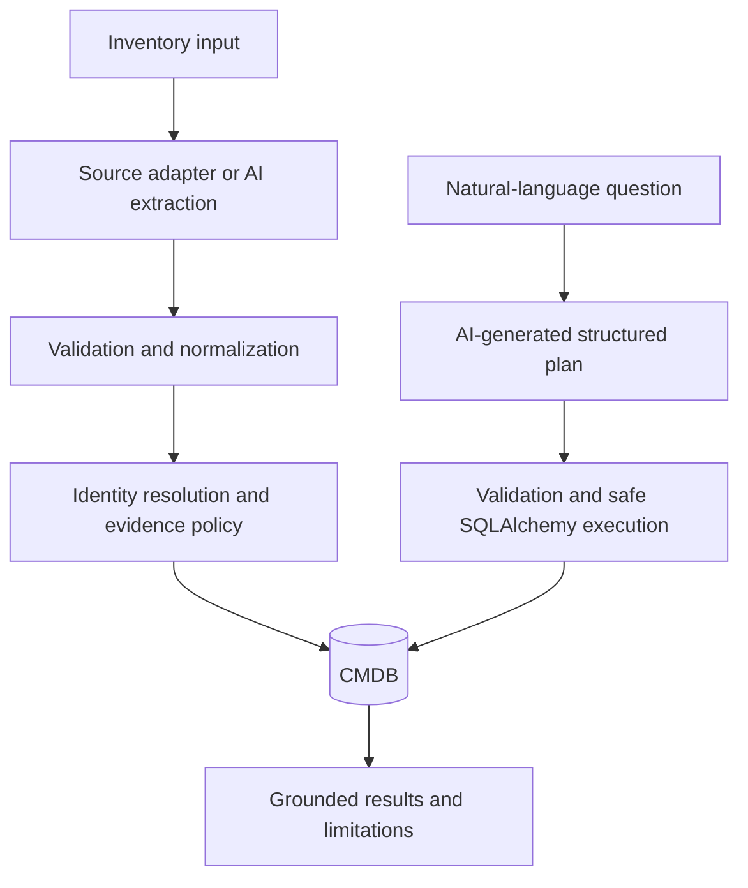

# AI-first CMDB

A Python backend that implements a Configuration Management Database (CMDB). It ingests raw files or text, resolves entities conservatively, preserves conflicting evidence, and answers natural-language questions through validated read-only query plans.

The backend supports ingestion, inventory reads, AI-assisted extraction, and natural-language queries. Start with the offline demo below. The [technical design](docs/design.md) explains the schema, identity rules, and engineering tradeoffs; the [assignment](STLabs_Backend_TakeHome_CMDB_Junior.md) describes the requirements.

## Quick start

Run these commands from the project root with Python **3.12+**:

```sh
python3 -m venv .venv
source .venv/bin/activate
python -m pip install -r requirements.txt
python -m app.demo
```

The commands below assume the virtual environment remains active. In a new shell, run `source .venv/bin/activate` again. Run `deactivate` when you are done.

You can run the demo without an API key or a running server. It loads the five sample files, shows the stored items and where their data came from, checks that uploading the same data again does not create duplicates, and answers the seven example questions. Everything runs through the API using a temporary SQLite database, which is deleted when the demo finishes. Your local `cmdb.db` is left untouched.

**Offline planning is explicitly mocked.** The demo supplies prewritten plans from [examples/demo_questions.json](examples/demo_questions.json) through a mocked OpenRouter HTTP transport. Validation, entity resolution, reconciliation, persistence, and SQL execution are real. This demonstrates backend behavior, not model accuracy. The terminal shows a short summary and the seven answers. Add `--json` to see the full API responses; UUIDs and timestamps vary between runs. See [sample API responses](docs/demo-output.json) for the full output.

```sh
python -m app.demo --json > /tmp/cmdb-demo.json
python -m pytest -q
```

To start the persistent API:

```sh
python -m uvicorn app.main:app --reload
```

Open `http://127.0.0.1:8000/docs`. Startup creates missing tables in `sqlite:///cmdb.db`. Existing data is retained; initialization is not a migration tool. Optional manual initialization is available through `python -m app.db`.

## Upload and inspect data

A configuration item (CI) is something the organization tracks: a device, user, or application. Attributes describe an item; relationships explain how items connect. For example, a laptop is assigned to a user who uses an application. Those connections let us ask security and ownership questions across inventories.

In `/docs`, **POST /ingest** provides a multipart file picker and source selector. **POST /ingest/raw** provides a `text/plain` editor for pasting JSON, CSV, YAML, or notes without escaping quotes or wrapping the content in JSON. Organization and recognized formats come from source configuration.

```sh
curl -X POST http://127.0.0.1:8000/ingest \
  -F 'source_id=hardware-yaml' \
  -F 'file=@input_data/sample_hardware.yaml'

curl -X POST 'http://127.0.0.1:8000/ingest/raw?source_id=hardware-csv' \
  -H 'Content-Type: text/plain' \
  --data-binary @input_data/sample_hardware.csv

curl 'http://127.0.0.1:8000/devices?os_family=macos'
curl 'http://127.0.0.1:8000/users?mfa_enabled=false'
curl 'http://127.0.0.1:8000/apps?limit=100'
```

Choose a configured source when available: source identity determines identifier scope. The default `uploaded-data` source detects familiar layouts and invokes OpenRouter for unfamiliar text-based data. Give each inventory system its own source configuration—for example, one for Jamf and another for Okta. An ID such as `123` in Jamf may refer to a different item than `123` in Okta. Uploading both files under the same source does not establish that their records describe the same person or device; matching across systems requires a shared, trusted identifier configured for that purpose.

Use `/ingest` to upload a file and `/ingest/raw` to send its contents directly, as shown above. Both endpoints validate and store the data in the same way. Uploading the same data again with the same source and configuration returns the previous ingestion result instead of creating duplicates.

For a normalization-only preview of all supplied files, use `python -m app.ingestion`. Add `--file sample_hardware.yaml` to inspect one file or `--include-raw` to retain source records. This command does not persist, merge entities, or call AI.

## Ask questions

With inventories stored and OpenRouter configured, use **POST /ask**:

```sh
curl -X POST http://127.0.0.1:8000/ask \
  -H 'Content-Type: application/json' \
  -d '{"question":"How many active devices are there?","limit":50,"offset":0}'
```

You can also ask “Which users don't have MFA?”, “Who uses GitHub?”, or “Which devices belong to users without MFA who use GitHub?”. The response includes an answer, the matching records, and the filters used to find them. `total` gives the number of matches; `limit` and `offset` let you page through them. Count questions return the number in `total` with `data: null`.

Answers depend on what has been uploaded. For example, a user is only counted as having no MFA if a source explicitly says MFA is disabled. A missing MFA value does not count. Check `warnings` for missing data or conflicting reports that could affect the answer.

With the sample files, the device/MFA questions return no matches because the hardware and Okta records cannot be reliably linked to the same users. Matching names alone are not enough. Likewise, an app listed as integrating with Salesforce is not treated as depending on Salesforce, so the dependency question returns no matches. Neither result proves those relationships do not exist; the files do not establish them.

When a question names a person, device, or app, the name must match a stored name or configured app alias. Capitalization does not matter, but typos and approximate matches are not supported. If several items match, the API returns `clarification_required` with candidate IDs so you can ask again using the right ID. Questions the API cannot handle return `unsupported`.

You can also ask from the terminal without starting the server. This reads the same configured database as the API and requires OpenRouter credentials:

```sh
python -m app.querying --question "Which users don't have MFA?"
```

The command returns matching users in `data`, along with the answer and any warnings. Upload data first; the offline demo does not populate this database. To preview the filters without running the query, add `--plan-only`. The API provides the same preview through **POST /ask/plan**.

The default application has no mock-AI fallback. Invalid output gets one corrective attempt; invalid/incomplete provider output returns 502, unavailability/authentication/rate limiting returns 503, and timeout returns 504. Invalid requests return 422; exceeded limits return 413; unsupported encoding/binary input returns 415. Errors contain a sanitized message and matching body/header request IDs.

## API surface

- **POST /ingest:** raw file, direct body, or JSON body with upload options; returns run, entity/relationship counts, replay status, and warnings.
- **POST /ingest/raw:** pasted raw text with source/format selection; returns the same ingestion summary.
- **GET /ingest/sources:** configured source choices and derived formats.
- **GET /devices, /users, /apps:** typed filters and `{data,total,limit,offset}` pagination. Defaults are 50/0; maxima are 100/10,000.
- **GET /ci/{id}:** attributes, identifiers, conflict state, incoming/outgoing edges, and bounded source attribution. Raw records are excluded from API projections.
- **POST /ask/plan:** validate a model-generated plan without execution.
- **POST /ask:** plan, resolve exact references, and execute a bounded read query; return an answer, unsupported response, or clarification.

The generated `/docs` and `/openapi.json` describe request/response schemas. [Design section 9](docs/design.md#9-api-design) explains contracts and errors in detail.

## Architecture and data model




The shared `configuration_items` table gives every entity an internal UUID. Joined type tables (`devices`, `users`, `applications`) store queryable attributes; `user_groups` stores group membership. `entity_identifiers` separates internal identity from external IDs scoped by organization, CI type, authority, and identifier type. A unique namespace/value key prevents collisions between unrelated source IDs.

`relationships` stores directed, typed edges: assignment, application usage, dependencies, integrations, and human ownership. Foreign keys give every edge a consistent endpoint. Type compatibility and organization agreement are checked in the ORM unit of work; database constraints enforce keys, edge uniqueness, and one current device assignee. Bulk SQL bypasses some ORM invariants and is not an application write interface.

`ingestion_runs` supports replay; `observations` retains source, record path, reliable observation time, extracted evidence, unresolved identity, and competing facts. **Provenance** is the evidence explaining where a stored fact came from. **Entity resolution** determines whether a new record refers to an existing CI. It uses stable scoped identifiers, never similarity of employee names or an assumption that hostnames/IPs are unique. If a record's identifiers point to different CIs, the record is quarantined without merging them.

Conflicts need a defensible rule: prefer a configured attribute authority; otherwise select the latest reliable observation only when competing timestamps are comparable. Incomparable contradictory evidence projects to NULL with retained candidates. File format and arrival time confer no priority, and `last_login`/`last_checkin` are not observation timestamps. Missing values never erase known facts.

Recognized sources use deterministic adapters; unfamiliar inputs map into the same validated normalized records through AI. Models cannot choose organization or identity namespaces. Pydantic and record-local evidence checks reject malformed or invented identifiers before persistence. Short `BEGIN IMMEDIATE` write transactions serialize identity lookup and persistence on SQLite. Accepted facts, quarantine evidence, relationships, and run summaries commit atomically; failures roll back. Exact replay adds no rows or provider calls; reformatted content can add evidence without duplicating CIs.

For queries, the model proposes a small plan rather than SQL. A deterministic compiler uses fixed SQLAlchemy tables, bound values, and correlated EXISTS. Nested constraints bind to the same related entity; counts avoid duplicate roots. The provider call finishes before opening the read transaction. Models see the question and allowed vocabulary, not database records; answer text is built from results without another model call. Valid structure does not guarantee correct interpretation, which is why plans and limitations remain visible.

See [the schema](docs/design.md#4-data-model-and-entity-relationships) for columns, indexes, invariants, and separate core-CMDB/ingestion diagrams. The implementation separates routes (`app/api`), persistence (`app/db`), validation (`app/schemas`), adapters (`app/ingestion`), identity/reconciliation services, provider code (`app/ai`), and query planning/execution (`app/querying`).

## Technology choices and tradeoffs

**Python 3.12+, FastAPI, and Pydantic v2** keep request validation, typed data boundaries, and interactive API documentation close to the implementation. Synchronous services simplify transaction handling; long-running imports would eventually need background jobs. Pydantic validates structure, not the truth of arbitrary model interpretations, so identity and evidence checks are separate.

**SQLAlchemy 2.x and a relational schema** fit exact identity lookup, attribute filtering, and short relationship traversals. Foreign keys, uniqueness constraints, and atomic writes protect a connected inventory. A document database would make cross-entity constraints less direct; a graph database would add infrastructure for deep traversal the prototype does not support. SQLAlchemy adds mapping complexity but keeps database behavior explicit and testable.

**SQLite** provides a local relational database without another service. Its serialized writes are a conscious prototype limit. PostgreSQL is the production path, but switching the URL is insufficient: migrations, native types, locking, initializer behavior, and database-specific indexes require implementation and tests.

**OpenRouter through a small HTTP client** supplies configurable models without an orchestration framework. AI adds value in unfamiliar data extraction and natural-language interpretation, while deterministic parsing, identity matching, evidence selection, and query execution remain auditable. The tradeoffs are latency, cost, provider failures, and data handling. No missing identity, access, or dependency is invented as enrichment.

**pytest and standard format parsers** keep most verification independent of a provider. Mocked HTTP exercises real service boundaries reproducibly, but cannot establish live model quality. Safe JSON/CSV/YAML parsing still needs source-specific semantics; valid syntax alone does not make a layout supported.

## Configuration and live AI

The offline demo works with the defaults. To configure the API or use live AI, copy the example settings file from the project root:

```sh
cp .env.example .env
```

Edit `.env` as needed. For live AI, uncomment `CMDB_OPENROUTER_API_KEY` and set it to your OpenRouter key. Then load the settings into your current shell before starting the server:

```sh
set -a
source .env
set +a
python -m uvicorn app.main:app --reload
```

The app does not load `.env` automatically. Repeat the `set -a`, `source .env`, and `set +a` commands in each new terminal where you run the app, and restart the server after changing settings. Keep `.env` private; it is excluded from git. Relative paths are resolved from the project root. The default source configuration is [examples/sample_sources.json](examples/sample_sources.json).

Credentials resolve as `CMDB_OPENROUTER_API_KEY`, then `OPENROUTER_API_KEY`, then the file configured by `CMDB_OPENROUTER_TOKEN_PATH` (default `token.txt`). Put only the key in that file. The default model is `openai/gpt-4o-mini`; override `CMDB_OPENROUTER_MODEL` as needed. Keys are loaded lazily, excluded from prompts/responses, and ignored by git. Recognized-source ingestion, inventory GETs, tests, and the default demo need no credentials.

```sh
# Optional live checks: make provider requests and may incur charges.
python -m app.ai --live-check
python -m app.demo --live --json > /tmp/cmdb-live-demo.json
```

The extraction smoke check uses synthetic data and writes no database. The live demo uses a temporary database and sends seven fixture questions to the provider (up to one correction per question); it checks answers against fixture expectations and fails if interpretation diverges. It does not send the database to the model. The offline demo is deliberately restricted to its bundled questions; the normal `/ask` service uses the configured live planner.

New sources are added through adapter registration or `adapter: "auto"`, with organization, identifier authorities, case rules, aliases, and optional reliable snapshot paths configured explicitly. Policies should be configured before loading. Changing policy changes replay versioning; deliberately reingest affected data. Policy changes are not applied to stored data automatically, and records are not automatically merged.

## Verification and known limits

Run `python -m pytest -q` for the full suite or `python -m pytest tests/integration -q` for the HTTP integration tests. Tests cover identity conflicts, unknown versus false, authority/freshness, all supplied layouts, atomic rollback, real SQLite locks, concurrent replay, provider failures, unsafe plans, bounded traversal, and grounded answers. Integration tests use temporary file-backed databases and block real HTTP. See the [integration test details](docs/design.md#phase-7-integration-verification-implemented).

The test suite and offline demo run without provider credentials. The live extraction checks use [synthetic fixtures](input_data/unfamiliar/README.md) to check selected fields, provenance, and replay. They do not measure complete extraction or general vendor compatibility. Dependencies use compatible version ranges in `requirements.txt`, without a complete version lock. Python 3.14.2 has been tested; Python 3.12 is supported by the project configuration but has not been verified.

Uploads are UTF-8 JSON, CSV, YAML, or text: at most **1 MiB**, **1,000 normalized records**, and **5,000 relationship assertions**. Unfamiliar AI input has a smaller **64 KiB** limit. PDF, Excel, and image extraction are excluded. Query plans support list/count, eq/in/is_null, and at most **two hops**; execution accepts at most **100 distinct literal references**. Coverage/count queries may still scan a large dataset.

One organization is configured per deployment. There is no authentication or tenant authorization. Access/group/integration observations are additive; omission does not revoke access. Historical graph queries, fuzzy identity merging, general reconciliation UI, streaming imports, background workers, and arbitrary SQL are excluded. New sources can reuse the workflow; new CI types or first-class attributes require deliberate schema changes.

Production work would add access controls, PostgreSQL migrations and concurrent upserts, query budgets, batch processing, backup/restore and evidence retention, provider-data handling policies, and metrics for latency, locks, conflicts, quarantine, replay, AI validation, and provider cost. These features are outside the prototype’s scope.

## AI usage

Runtime AI extracts unfamiliar inventory input and translates questions into validated query plans. The prompts are in [extraction.md](app/ai/prompts/extraction.md) and [planning.md](app/querying/prompts/planning.md); deterministic code validates the results before database writes or queries.

Codex assisted with design, implementation, tests, and documentation, guided by the user. See the [coding session transcript](docs/codex-session.md).
