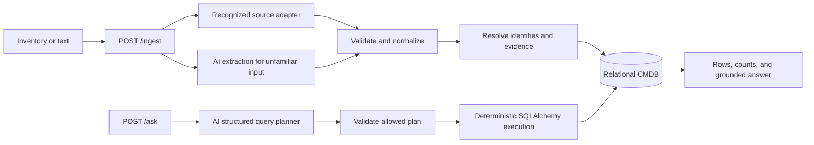
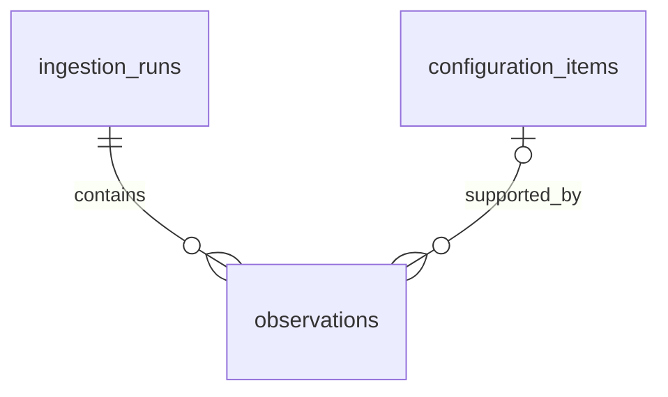

# AI-first CMDB: technical design

**Status: Phases 1–8 implemented; limited live extraction smoke checks verified.** The database foundation, deterministic preparation, identity/evidence/relationship services, transactional replay, and inventory REST API are implemented and tested. OpenRouter extraction is tested with mocked responses and incremental live checks of ten synthetic unfamiliar-source fixtures. Selected fields, provenance, and replay passed; complete extraction and broad vendor compatibility are not established. See [recorded live results](unfamiliar-live-results.json). Natural-language planning has a preview API/CLI; POST /ask now resolves references and executes validated plans for grounded answers. The implementation target is the 6–8-hour assignment in [the specification](../STLabs_Backend_TakeHome_CMDB_Junior.md). See [setup and verification](../README.md#setup-and-running).

Phase 1 uses SQLAlchemy joined-table inheritance and a validated ORM session for cross-table invariants. UTC-aware timestamps are restored explicitly on SQLite reads. Initialization uses create_all, not migrations. The full database suite now runs; its earlier missing-dependency blocker is resolved. Email validation is a modest inventory-address syntax check rather than complete RFC or delivery validation.

Phase 2 prepares all five supplied layouts, with explicit source configuration, raw-record evidence, normalization, bounded warnings, and safe parsing. YAML aliases are rejected entirely, and only configured snapshot paths supply observation time. The command-line preview remains preparation-only.

Phase 3 follows identity resolution → evidence selection → relationship target resolution → transactional persistence/replay → API integration. New and duplicate records are grouped by exact scoped keys before creating CIs. Attribute and assignment projections use retained evidence for affected CIs. Root records are materialized before reference targets; both use the same resolver. Application label aliases are configuration within an application-name authority. SQLite writers acquire a short BEGIN IMMEDIATE transaction before identity reads. POST /ingest and the four inventory GET endpoints were delivered in Phase 3; POST /ask was added in Phase 6.

Upload/extraction implementation: POST /ingest accepts multipart files and the legacy JSON envelope, plus direct raw bodies. POST /ingest/raw provides a text/plain editor; GET /ingest/sources supplies source/format choices. Organization and known formats come from configuration. The default uploaded-data source uses auto detection, deterministically mapping recognized layouts and asking OpenRouter only for unfamiliar content. Model credentials are loaded lazily from token.txt or environment variables, never included in prompts or responses. AI DTOs cannot choose namespaces or organization. Pydantic, literal-identifier evidence, and attribute-evidence checks precede the existing persistence boundary. AI origins and evidence are retained.

All transports share content limits, consistent errors, and replay. Replay is checked before model invocation and rechecked in the write transaction; its version covers source policy, model/prompt version, and parser format. Concurrent first-time requests may both call the provider, but only one run commits. A bounded body middleware checks actual incoming bytes before multipart parsing, including chunked bodies. No credentials or HTTP transport metadata alter entity identity.

New practical limits: uploads are UTF-8 text, not PDF/Excel/image processing. AI input is limited to 64 KiB within the overall 1 MiB upload limit, with bounded output and one validation repair attempt. Literal evidence and schemas do not prove all semantic claims. The live smoke check could not reach OpenRouter; mocked integration, credential handling, and error paths are verified.


Phase 4 completion review retains the existing extraction workflow and closes validation gaps: provider envelopes are shape-checked; duplicate JSON keys and non-finite numbers are rejected; correction gets bounded prior output and an actionable validation hint; attributes/identifiers must cite record-local evidence; targets can cite their own records; obvious display labels cannot masquerade as external IDs; explicit string/native boolean contradictions are rejected. The validation/prompt version is extraction-v2, so previous cached extractions are not reused under the revised rules. No HTTP contract, table, or migration changes were required.

`python -m app.ai --live-check` is an explicit optional provider smoke test on synthetic data, without database writes or credential output. It returns a nonzero exit and sanitized JSON on failure. Phase 4 added 34 completion checks after the upload feature; Phase 5 added 86 planning checks; Phase 6 adds 38 execution/API checks, bringing the full suite to 404 tests. The live check still cannot connect from this sandbox; mocked-provider verification is complete.

Implementation adjustments and deliberate limits:

- An inconsistent connected identity group is quarantined together, rather than accepting some records according to their order. Existing CIs are never merged or changed by that group.
- Reference CIs support stable identifiers for devices and users as well as applications. Name-only people remain unresolved.
- Configured aliases currently map application names to canonical names within their declared authority. Direct label-to-external-ID alias configuration is deferred; catalog IDs attach through the shared canonical name. Both old-label and canonical keys are checked so new aliases cannot hide pre-existing identity conflicts.
- BEGIN IMMEDIATE serializes SQLite writes before lookup; lock contention returns 503. A committed racing replay returns the original summary. General-purpose transaction retries remain deferred.
- CI details bound supporting evidence to 20 observations per field, with full counts, in addition to the 20 recent-observation summaries and paginated edges. Internal evidence is retained in full.
- Policy changes require deliberate reingestion of affected data; there is no background reconciliation or automatic merge. Dependency ranges remain in requirements.txt; a complete exact-version lock is deferred.

All **437 tests pass** (including 86 Phase 5, 38 Phase 6, 31 Phase 7, and 2 demo checks). The complete suite covers model constraints, all fixtures, alias safety, conservative identity matching, conflicts, missing values, assignments, all relationship types, replay, atomic rollback, concurrent replay/locking, pagination, attribution, HTTP errors, and end-to-end ingestion/read flows. OpenRouter extraction is now integrated; natural-language execution and grounded answers are integrated.

## 1. Overview and goals

A configuration item (CI) is something an organization needs to track to understand its technology environment. This prototype models three kinds: **devices, users, and applications**. A laptop's operating system is an attribute; the fact that a person is assigned that laptop is a relationship. Relationships make a CMDB more useful than separate inventory lists: they let us ask which devices belong to people who lack MFA, or which applications depend on a particular service.

The difficult part is combining evidence from different systems. Two exports may describe the same device using different identifiers, disagree about its status, or reference a person only by name. The CMDB must distinguish what it knows from what it cannot safely infer.

The proposed service accepts structured inventories and unfamiliar text, normalizes them into a common model, resolves identities using explicit rules, and stores queryable relationships. AI helps interpret unfamiliar inputs and translate natural-language questions. Validated application logic remains responsible for identity, persistence, and database queries.

The prototype prioritizes reliable ingestion, explainable decisions, and a small useful query language. New infrastructure or SaaS sources should fit through adapters or AI-assisted extraction without changes to the core workflow or database schema, provided their data maps to the three supported CI types and relationship vocabulary. New CI types or new first-class queryable attributes would require deliberate model changes. Dataset size is not fixed by the examples; request and query limits bound work per operation.

## 2. Architecture at a glance




There are two workflows sharing one data model. Ingestion translates source records into normalized entities and relationship assertions. Querying translates a question into a limited read plan. Both workflows use strict Pydantic schemas at the AI boundary.

Routes handle HTTP contracts. Adapters understand source layouts. Ingestion services coordinate normalization, identity resolution, and persistence. The AI client handles provider calls; the query compiler translates validated plans into SQLAlchemy expressions. Keeping these responsibilities separate allows most tests to run without a network or a real LLM.

Organization and source definitions live in a small versioned configuration file. Each source definition names its organization, source instance, adapter, identifier authorities, optional attribute authority, and timestamp semantics. Alias mappings are configuration too. Source names and mappings are not hardcoded into the resolver. Configuration is trusted operator input; uploaded documents cannot declare themselves authoritative or choose a different organization's identity scope.

The prototype serves one configured organization per deployment. Organization IDs are still explicit in stored identities and ingestion runs so scope is never implicit. This is not a claim of tenant isolation or production authorization.

## 3. Technology choices and tradeoffs


| Choice                                    | Reason and tradeoff                                                                                                                                               |
| ----------------------------------------- | ----------------------------------------------------------------------------------------------------------------------------------------------------------------- |
| Python 3.12+ and FastAPI                  | Clear request models and a small REST service with generated API documentation. Synchronous request handlers are sufficient for the prototype.                    |
| SQLAlchemy 2.x                            | Typed relational models, transactions, and composable safe queries. More modeling work than storing documents, but relationships and constraints remain explicit. |
| SQLite                                    | Easy local setup and isolated tests. Suitable for the demonstration; concurrent writes are limited.                                                               |
| Pydantic v2                               | One validation boundary for API inputs, normalized records, extraction output, and query plans. Schema validity does not itself prove a fact is true.             |
| OpenRouter through a small HTTP client    | Configurable model access without an agent framework. Model reliability, cost, latency, and data exposure remain operational concerns.                            |
| pytest                                    | Unit tests for policy and integration tests for complete workflows. AI responses are mocked by default.                                                           |
| Standard JSON/CSV readers and safe PyYAML | Deterministic parsing of recognized structures. A parser understands syntax; adapters still need to understand each source's meaning.                             |


A relational database is a good fit because identity keys, typed attributes, and directed relationships need constraints and joins. A graph database would be useful for unrestricted deep traversals, but this design needs only bounded paths. A vector database would not solve entity identity or precise security filtering. Neither is needed for this timebox.

Dependencies use compatible ranges in requirements.txt; an exact lock remains deferred. Secrets and the selected OpenRouter model will come from environment configuration; credentials must never appear in fixtures, source control, or saved development transcripts.

## 4. Data model and entity relationships

The model separates **internal identity**, **attributes**, and **evidence**. A CI gets an internal UUID that remains stable even when a hostname or email changes. Type-specific tables provide normal relational columns for queries. External identifiers link records from different systems to that internal identity.

**Provenance** means recording where a fact came from. If a device's status looks wrong, an engineer should be able to find the source, record, and observation that supplied it. The prototype keeps normalized observations and the original parsed record. It does not attempt a complete historical CMDB or an audit event platform.

### Proposed tables

UUIDs use `VARCHAR(36)` in SQLite. Times are UTC datetimes, JSON columns use SQLAlchemy JSON, and enum-like values use CHECK constraints. Below, `!` means required and `?` means nullable. All `id` columns are primary keys; all listed references are foreign keys. Deletion is outside the public API.


| Table                 | Columns                                                                                                                                                                                                                                                                                     | Constraints and initial indexes                                                                                                                                                                                    |
| --------------------- | ------------------------------------------------------------------------------------------------------------------------------------------------------------------------------------------------------------------------------------------------------------------------------------------- | ------------------------------------------------------------------------------------------------------------------------------------------------------------------------------------------------------------------ |
| `configuration_items` | `id UUID!`, `organization_id TEXT!`, `kind TEXT!`, `display_name TEXT!`, `is_reference BOOLEAN!`, `field_state JSON!`, `created_at DATETIME!`, `updated_at DATETIME!`                                                                                                                       | Kind is device/user/application. Index `(organization_id,kind,id)`. Exactly one matching subtype, enforced by the write service in one transaction. `field_state` is explained below.                              |
| `devices`             | `ci_id UUID! PK/FK configuration_items`, `hostname TEXT?`, `ip_address TEXT?`, `mac_address TEXT?`, `serial_number TEXT?`, `os_family TEXT?`, `os_version TEXT?`, `location TEXT?`, `status TEXT?`, `encrypted BOOLEAN?`, `device_type TEXT?`, `department TEXT?`, `last_checkin DATETIME?` | Status active/inactive/unknown when present. Nonunique hostname index; indexes `(os_family,ci_id)` and `(status,ci_id)`. Hostnames, IPs, and MACs are not identity constraints.                                    |
| `users`               | `ci_id UUID! PK/FK configuration_items`, `name TEXT?`, `email TEXT?`, `team TEXT?`, `department TEXT?`, `title TEXT?`, `status TEXT?`, `mfa_enabled BOOLEAN?`, `last_login DATETIME?`                                                                                                       | Status active/inactive/suspended/unknown. Index `(mfa_enabled,ci_id)`; nonunique email lookup index. Identity uniqueness is enforced in identifiers, not the email projection.                                     |
| `applications`        | `ci_id UUID! PK/FK configuration_items`, `name TEXT?`, `app_type TEXT?`, `vendor TEXT?`, `category TEXT?`, `deployment TEXT?`, `owner_team TEXT?`, `reported_user_count INTEGER?`, `sso_enabled BOOLEAN?`                                                                                   | Type saas/on_prem/unknown. CHECK count >= 0. Nonunique name index. Reported count is distinct from counted user-access edges.                                                                                      |
| `user_groups`         | `user_id UUID! FK users`, `group_name TEXT!`                                                                                                                                                                                                                                                | Composite PK `(user_id,group_name)`. Groups remain many-valued; membership does not automatically imply team.                                                                                                      |
| `entity_identifiers`  | `id UUID!`, `ci_id UUID! FK configuration_items`, `namespace TEXT!`, `value TEXT!`, `created_at DATETIME!`                                                                                                                                                                                  | UNIQUE `(namespace,value)`; index `ci_id`. The namespace contains organization, CI type, authority, and identifier type. Every persisted CI has at least one identifier.                                           |
| `relationships`       | `id UUID!`, `from_ci_id UUID! FK configuration_items`, `to_ci_id UUID! FK configuration_items`, `relation_type TEXT!`, `created_at DATETIME!`                                                                                                                                               | UNIQUE `(from_ci_id,to_ci_id,relation_type)`; CHECK endpoints differ. Index `(from_ci_id,relation_type,to_ci_id)` and reverse `(to_ci_id,relation_type,from_ci_id)`. Partial UNIQUE on from_ci_id for assigned_to. |
| `ingestion_runs`      | `id UUID!`, `organization_id TEXT!`, `source_id TEXT!`, `format TEXT!`, `payload_sha256 TEXT!`, `policy_version TEXT!`, `received_at DATETIME!`, `completed_at DATETIME!`, `result JSON!`                                                                                                   | UNIQUE `(organization_id,source_id,payload_sha256,policy_version)`. Stores committed processing outcomes, including warnings and quarantined records.                                                              |
| `observations`        | `id UUID!`, `run_id UUID! FK ingestion_runs`, `record_key TEXT!`, `ci_id UUID? FK configuration_items`, `observed_at DATETIME?`, `raw_record JSON!`, `normalized_record JSON!`, `origin TEXT!`, `resolution_status TEXT!`                                                                   | UNIQUE `(run_id,record_key)`; index `(ci_id,observed_at)`. Origin adapter/ai; status resolved/unresolved/identity_conflict. A null ci_id is allowed for quarantined evidence.                                      |


`field_state` is lightweight bookkeeping for the current projection: each observed attribute records `selected` or `conflict` and supporting observation IDs. A conflicted scalar projects to NULL; a missing attribute is also NULL but has no observed state. This makes queries simple while details can distinguish conflict from missing data. The display name is only a convenience label, falling back to kind plus internal ID if necessary; it is never evidence of identity.

Observations store relationship assertions alongside normalized attributes, using a record path and resolved target IDs where available. They are attached to the originating CI, rather than having foreign keys to mutable relationship rows. This preserves evidence when a current assignment changes without introducing relationship history tables. Root and nested entity records get distinct stable paths within a run. Secondary source fields remain in the original record and are not automatically queryable attributes.

### Core CMDB model

The core model stores configuration items, their identifiers, and their relationships.

```mermaid
erDiagram
  configuration_items ||--o| devices : specializes
  configuration_items ||--o| users : specializes
  configuration_items ||--o| applications : specializes
  users ||--o{ user_groups : has
  configuration_items ||--|{ entity_identifiers : identified_by
  configuration_items ||--o{ relationships : from
  configuration_items ||--o{ relationships : to
```


The three optional subtype links collectively require exactly one subtype. The service also checks identifier organization/type and relationship endpoint compatibility. SQL constraints handle key uniqueness and references; a small number of cross-table semantic invariants remain application checks.

### Ingestion and provenance

Ingestion runs group the evidence received in one upload. Observations link that evidence to the core model; configuration_items below is the same table shown above. An observation can remain unlinked when its identity is unresolved or conflicting.




### Relationships


| Type              | Direction                               | Meaning                                                                                      |
| ----------------- | --------------------------------------- | -------------------------------------------------------------------------------------------- |
| `assigned_to`     | device → user                           | Current assignment, at most one user per device. It does not establish legal ownership.      |
| `uses`            | user → application                      | Observed access or assignment, not measured usage frequency.                                 |
| `depends_on`      | device/application → device/application | Explicit dependency. Cycles are allowed; transitive analysis is deferred.                    |
| `integrates_with` | application → application               | A source's directed integration assertion. It does not imply a dependency or a reverse edge. |
| `owned_by`        | application → user                      | Explicitly identified human owner. Team owners instead populate owner_team.                  |


Edges connect CI IDs within the same organization. A device query follows outgoing assigned_to edges; finding dependents of an application follows incoming depends_on edges from that application. These are normal indexed joins, not string comparisons between names.

NULL means the value is unavailable or unresolved. In particular, **unknown MFA is not false MFA**. API detail responses explain the reason for NULL through field_state and evidence. Boolean false always means an explicit, selected negative observation.

## 5. Identity resolution

Entity resolution answers: “Does this new record describe a CI we already know?” It is separate from deciding which of two status values to display. A wrong merge can attach one person's access or security posture to another person, so the prototype favors stable identifiers and explicit configuration over fuzzy matching.

### Identifier namespaces

An identifier is only meaningful within its issuing scope. A device ID from one inventory system cannot safely match the same text from another. Every namespace is constructed by one shared helper from this tuple:

`(organization_id, ci_type, authority_id, identifier_type)`

Store it as a canonical JSON-array string, with no optional components or alternate spellings. Each component is a validated configuration ID; identifier-specific normalization applies to the separate value. For example:


| Namespace tuple                                        | Value    | Interpretation                                                          |
| ------------------------------------------------------ | -------- | ----------------------------------------------------------------------- |
| `["org-a","device","jamf-prod","device_id"]`           | `42`     | Jamf's local device 42.                                                 |
| `["org-a","device","inventory-east","device_id"]`      | `42`     | Another system's device 42; not the same key.                           |
| `["org-a","device","approved-serial-domain","serial"]` | `SN-804` | Serial identity shared only by sources configured to trust this domain. |


**UNIQUE(namespace,value) is sufficient** if construction is canonical and the resolver verifies that namespace organization/type agrees with the CI. The tuple includes identifier type, so an additional independently mutable identifier_kind column would be redundant. The tradeoff is that namespace construction becomes a critical shared contract; tests must forbid ad hoc string construction. Explicit columns could replace the encoded tuple later if SQL reporting on namespace components becomes important.

External IDs retain their authority's case rules. Email can be a shared key only when configuration declares an appropriate authority and normalization rule. Generic lowercasing, shared mailboxes, recycled accounts, and unverified addresses are not universal identity guarantees. Serial numbers likewise require a trusted scope. The prototype drops blank identifiers and quarantines contradictory stable keys; broader placeholder-value screening remains the source adapter/configuration owner's responsibility. IPs, MACs, and hostnames remain descriptive evidence by default.

### Resolution behavior

The resolver looks up **all** usable keys on a record before writing:

- If none match and at least one trusted key exists, create a CI and attach the keys.
- If all matched keys point to one CI, reuse it and attach compatible new keys. Different systems can therefore identify one CI through a shared trusted key.
- If keys point to different CIs, do not merge, update attributes, or attach identifiers. Quarantine that record as an identity conflict and preserve it in observations with the candidate CI IDs.
- If no safe key exists, retain the record as unresolved evidence. A referenced person is not fabricated from a name alone.

For example, a new device record carries a local inventory ID resolving to CI A and a trusted serial resolving to CI B. Both keys are valid individually, but together they expose inconsistent identity evidence. The response flags the conflict; neither CI changes. A human must correct configuration/data before reprocessing. There is no automatic merge or reconciliation UI in the prototype.

Duplicates with agreeing keys resolve to one CI, and unique edge constraints prevent duplicate relationships. Conflicting attribute values on those duplicates follow the evidence policy below. Two devices with the same hostname remain separate when their stable keys differ. Similar user names never trigger automatic merging, even when the names appear unique in the current database.

### Configured aliases and reference CIs

Sources often reference applications using labels rather than IDs. Current configuration maps a source-scoped label to a canonical application name within its application-name authority. A catalog record can then attach its external ID. Direct alias-to-external-ID mapping is a possible extension. It may also declare an organization-specific application-name authority where labels are known to be unique. Normalization and aliases apply within that declared scope; they are not global product-name rules.

A known key without detailed inventory can create a **reference CI**, with is_reference=true. Later inventory enriches that same CI. Without a shared-name guarantee or mapping, a label creates only a source-scoped reference, so two similarly named deployments do not collapse. Ambiguous mappings are configuration errors; ambiguous query names require clarification. If later data exposes two already-created CIs for one purported identity, use the same conflict path rather than adding an implicit merge feature.

## 6. Ingestion pipeline

The ingestion problem is translation plus reconciliation: different source layouts need to become the same internal record shape, while preserving enough evidence to explain the result. Adding an adapter changes how a source is read, not how identities or database writes work.

### Request and workflow

```json
{
  "organization_id": "org-a",
  "source_id": "inventory-east",
  "format": "json",
  "content": "[{\"asset_id\":\"A-17\",\"hostname\":\"workstation-17\"}]"
}
```

For file and paste inputs, the selected source supplies organization and identity policy; named adapters also supply format. The legacy JSON envelope remains valid. The configured source selects an adapter and identity policy. Formats are json/csv/yaml/text. The envelope carries textual content, not server file paths or remote URLs. Reliable observation times come from configured source fields; the client does not get an unrestricted timestamp override.

1. **Validate and parse.** Enforce source/organization configuration and bounded input. Use deterministic parsers for known structures; malformed known input returns an error rather than silently invoking AI. Safe YAML excludes object construction; reject duplicate mapping/header keys and malformed CSV rows.
2. **Extract a common representation.** An adapter, or AI for unfamiliar input, produces typed device/user/application records with attributes, identifiers, relationship references, evidence paths, and optional reliable observation time. Pydantic validates the same contract for both paths.
3. **Normalize.** Convert source-specific statuses, OS descriptions, booleans, timestamps, and addresses into common representations. Source field mappings belong to adapters/configuration. Preserve original values; do not turn an unknown encryption description into false or treat a group as a team.
4. **Resolve identities and evidence.** Coalesce keys across the batch, resolve target references, and classify unresolved/identity-conflicting records. Build eligible entities before edges so forward references work. A failed target does not cause an invented relationship.
5. **Project and persist.** Apply the conflict policy, upsert selected attributes and current edges, and store observations and run results in one short transaction. Recheck identities inside that transaction because preflight lookups alone cannot prevent races.
6. **Respond.** Return distinct entity and edge counts, quarantine counts, unresolved references, and bounded warning details with source record paths.

Proposed operational limits are 1 MiB per upload, 1,000 extracted entity records, 5,000 relationship assertions, and bounded parser nesting. Oversize input is rejected, never silently truncated. These are per-request limits, not total database cardinalities.

### Source authority, freshness, and conflict

CMDB sources disagree because they observe different things, update at different times, or contain mistakes. We need a repeatable policy so the final answer does not depend on upload order. **File format says nothing about trust.**

For each scalar attribute, apply this small deterministic policy to retained nonmissing observations:

1. If a configured source is authoritative for that attribute, consider its nonmissing observations first. The prototype allows one designated authority per attribute; weaker evidence remains available for provenance and for filling attributes the authority never supplies.
2. Within the eligible evidence, select the most recent **reliable observation** only when all competing observations can be temporally compared. Equal values do not conflict. If timestamps are missing on a competing value, or equal-time observations disagree, there is no defensible temporal winner.
3. If different values remain without a winner, mark that field conflicted, project NULL, and return a warning. Preserve all candidates. A later upload cannot silently replace a known value merely by arriving later.

A configured export time may timestamp a snapshot if the source documents that meaning. A record's modification time may timestamp only the fields it actually covers. `received_at` records when the API saw an upload; it does not establish when its contents were true. **last_login and last_checkin are activity attributes, not observation timestamps.** An adapter must not use them to order inventory status, ownership, or profile data.

This policy sometimes turns a previously selected field into an unresolved one when incomparable contradictory evidence arrives. That is deliberate: retaining whichever value arrived first would hide uncertainty and make ingestion order affect answers. Missing/null/blank values never erase known facts. Details distinguish missing from conflict; ordinary filters treat both as unavailable.

The prototype recomputes affected fields from retained observations using a simple pure selection function. It needs no reconciliation queue or per-source confidence scores. Policy configuration is fixed for a database during a demonstration; changing it requires deliberate reprocessing, not an invisible background change. Automated correction, expiring old evidence, and source-health-based authority are production work.

### Relationships, provenance, and idempotency

Assignment is single-valued, so competing assigned_to assertions use the same authority/freshness policy. If unresolved, expose no current assignment and preserve the candidate targets in evidence. Name-only assertions cannot override an identified assignee. Access, groups, integrations, dependencies, and human-owner assertions are additive sets in this prototype; omission is not a revocation. Integrations never become dependencies automatically.

Each observation stores its source run, record path, parsed raw record, normalized evidence, observation time when reliable, and resolution outcome. The current field_state links selected/conflicting attributes and assignment to supporting observations. This is enough to debug an update without building full temporal relationship querying. CSV provenance preserves string-valued rows; it is not byte-perfect file archival.

An exact replay is recognized by organization, source, content hash, and policy version (including adapter and alias configuration). It returns the prior committed result with replayed=true and adds nothing. Reformatted equivalent data may add evidence, but must not duplicate CIs or edges. Stable unresolved record paths prevent duplication within a run. Corrected identities require a new policy version or corrected content to avoid replaying a quarantined result.

### Transactions and failures

Parsing and AI calls happen before taking a database write transaction. Valid records, quarantined evidence, projections, relationships, and the run summary then commit together. Quarantine is a documented successful processing outcome, not a hidden exception: those records make no identity or attribute changes. Unexpected validation/persistence failures roll back the entire run. A rejected malformed document is not archived in the database.

SQLite uses foreign keys, WAL, and a short busy timeout. Unique constraints prevent duplicate keys and edges. On a concurrent replay, return the committed winner after rollback/recheck; otherwise return retryable 503 if contention prevents completion. A general multiwriter retry engine is deferred.

Example successful processing response:

```json
{
  "run_id": "ac57ec20-8720-4f64-b14e-07e666060fd3",
  "replayed": false,
  "records": {"received": 1, "resolved": 1, "quarantined": 0},
  "entities": {"created": 1, "updated": 0, "unchanged": 0},
  "relationships": {"created": 0, "removed": 0, "unchanged": 0},
  "warning_count": 0,
  "warnings": [],
  "unresolved_reference_count": 0
}
```

Counts refer to extracted entity records and distinct CIs/edges; observations are separate evidence records. An identity conflict yields a quarantined count and warning with candidate IDs. An attribute conflict can update a CI's projection to NULL and reports the affected field. Warning details are capped at 50, with full totals retained.

## 7. AI integration

**Implemented with mocked-provider verification and limited live smoke checks.** Initial sandbox connection attempts failed; later network-enabled requests reached OpenRouter. Ten unfamiliar synthetic fixtures passed selected-field, provenance, and replay checks across incremental reruns. Structured input uses pointer-only evidence; the extraction-v7 prompt demonstrates numeric IDs, canonical field normalization, and evidence spanning separate entity/assignment tables. Correction hints identify the failing path and common enclosing source scope without changing the validator or exposing private hints in API errors. See [fixture coverage and completeness limits](../input_data/unfamiliar/README.md).

AI is useful when the source's layout or meaning is unfamiliar, and when a person asks a question without knowing the database schema. It is a poor authority for persistent identity decisions. Separating interpretation from execution preserves useful flexibility without granting the model database control.

For unfamiliar input, OpenRouter receives bounded source content, the normalized record schema, supported relationship definitions, and instructions to preserve unknown values as missing. Extracted identifiers require source paths or quoted evidence spans. Pydantic checks types, lengths, counts, enums, timestamps, and references; literal identifier evidence is checked against the submitted content. An LLM-proposed identifier must still be allowed by source configuration before the resolver trusts it.

These checks reduce invented facts but cannot prove every semantic interpretation correct. AI-derived observations are labeled as such and remain inspectable. Recognized inputs use deterministic adapters; AI is not a fallback for broken known-source data. Adding an unfamiliar source still requires trusted organization/identity configuration even if no custom adapter is needed.

Malformed/schema-invalid model output gets one corrective retry with a bounded copy of the previous output and a validation hint. Provider envelope failures, truncation, and transport failures are returned directly rather than blindly retried. Persistent invalid output returns 502; provider unavailability/rate limiting returns 503; timeout returns 504. No data is written before validation succeeds. Tests use an injected mock client; the optional live provider smoke command is documented in the README. Record-scoping and explicit boolean checks strengthen evidence validation but do not prove every semantic association. Strict record-local evidence may reject ambiguous or mixed-style citations; correction requests consistent pointers or quotes.

Questions and source text are untrusted input, including any embedded instructions. Models receive neither credentials nor executable database tools. Extraction sees only the uploaded content needed for that request; the planner sees the question and allowed query vocabulary. Real inventory can contain personal or confidential data, so operator approval of provider/model data handling is a deployment concern. The prototype will not log complete payloads, prompts, or secrets by default.

## 8. Natural-language querying

**Phases 5–6 are implemented: POST /ask/plan and `python -m app.querying` preview plans; POST /ask resolves references, executes, and returns grounded answers.**

The preview returns `executed: false` and a discriminated `result`: `planned` with a versioned plan, `unsupported` with a reason and fixed example questions, or `clarification_required` with a question about intent. It never reads the database. Database-dependent ambiguity and candidate IDs are handled by the deterministic resolver at /ask; the model cannot invent candidates. Names, emails, hostnames, and CI UUIDs in plans must occur in the question, with configured aliases preserved literally for later resolution. Request pagination overrides model pagination. The shared directed relationship vocabulary and per-type field registry are validated before returning a plan. One correction attempt is allowed; upstream errors are returned directly. These checks constrain structure and references but cannot prove semantic interpretation. The additive preview endpoint allows Phase 5 to be tested independently without pretending to answer questions.

A question such as “Which devices belong to users without MFA?” describes a small relational query. **Query planning** translates that meaning into a constrained data structure: select devices, follow their assignee edge, and test MFA=false on that user. The application validates the structure and builds the database query itself.


The LLM never receives the entire CMDB, and arbitrary SQL is never accepted. Answer text is built deterministically from actual query results; a second narrative model call adds little value in this prototype.

### Limited plan schema

A version-1 executable plan has:


| Field             | Meaning                                                                                                                    |
| ----------------- | -------------------------------------------------------------------------------------------------------------------------- |
| `operation`       | list or count.                                                                                                             |
| `root`            | device, user, or application. Organization scope is supplied by the server, never the model.                               |
| `where`           | AND of scalar predicates: `{field, operator, value}`. Operators eq, in, is_null; is_null omits value.                      |
| `exists`          | AND of related-entity constraints containing relation, direction (out/in), target_kind, where, and optional nested exists. |
| `limit`, `offset` | Bounded list pagination. Count ignores pagination. Request envelope values override model proposals.                       |


All models forbid extra fields. A registry permits fields by type: device hostname/os_family/status/encrypted; user name/email/team/status/mfa_enabled; application name/app_type/owner_team; plus exact ci_id for each type. Values must match field types. Unknown/conflicted values satisfy is_null and do not satisfy eq false.

Plans allow at most two relationship hops, eight predicates per node, four related constraints per node, and twenty values in an in predicate. List limit is 1–100, default 50; offset is 0–10,000. No arbitrary projections, SQL fragments, aggregates beyond count, OR/NOT expressions, or transitive graph traversal are included. This is an intentionally small language whose behavior can be tested thoroughly.

For a generic device/security question:

```json
{
  "version": 1,
  "operation": "list",
  "root": "device",
  "where": [],
  "exists": [{
    "relation": "assigned_to",
    "direction": "out",
    "target_kind": "user",
    "where": [{"field": "mfa_enabled", "operator": "eq", "value": false}],
    "exists": []
  }],
  "limit": 50,
  "offset": 0
}
```

Every related constraint means **there exists one related entity satisfying all its predicates and nested constraints**. To also require that assignee to use an application, nest an outgoing uses constraint inside the same assigned_to constraint. Separate sibling constraints may match different entities; the planner must not use that structure when the question refers to the same person.

The compiler uses correlated EXISTS expressions and bound parameters against fixed SQLAlchemy models. Edge direction and target type are checked against the relationship registry. Counts count root CIs before pagination; EXISTS avoids duplicate rows from many relationships. Lists order by internal CI ID. Exact application name references go through configured aliases and database identifier lookup; multiple matches produce clarification rather than arbitrary selection.

### Phase 6 execution details and adjustments

The compiler uses SQLAlchemy Core aliases for the fixed CI/subtype/relationship tables, while persistence continues using the ORM. This keeps self-kind application dependencies and mixed-type traversals explicit. The service revalidates plans at the execution boundary, resolves references, and runs counts, pagination, projections, and warnings in one read transaction. The provider call completes before any database session is opened. Answer text is a deterministic summary of the total and returned page; it does not invent explanations or make a second model request.

Literal names, hostnames, and emails match exact current attributes with SQLite ASCII case-insensitive equality. Non-ASCII characters retain exact matching semantics; full Unicode collation is deferred. Application-name lookup also checks canonical identifiers in configured app-name authorities using each source's normalization rules. Raw-name and alias matches are combined: if they identify different CIs, clarification is required. No fuzzy matches, cross-authority alias expansion, or identity merges occur. Unmatched references yield empty membership plus a missing-reference warning. For IN, known values still match and each missing value is disclosed. Lookup does not assume a unique name even when other predicates would narrow the eventual result.

The returned plan preserves the user's literal names; `resolved_references` separately records the internal ID chosen for each reference (null if missing). Ambiguity returns up to 20 candidates in UUID order and a full `candidate_total`; rephrase with a candidate's internal UUID. As a defensive operational addition, execution allows at most 100 distinct literal reference values across the entire plan, otherwise returning unsupported rather than weakening it. Existing per-node plan bounds remain unchanged. No database tables, migrations, or new dependencies are needed.

Coverage warnings count distinct reachable CIs along each path, applying ancestors' scalar filters but omitting sibling/descendant EXISTS and the current node's filters. This deliberately exposes evidence that would disappear under the requested filter; counts can overlap and are not additional matches. Unknown and explicitly conflicted queried attributes are disclosed separately. is_null intentionally selects unknowns, so it does not emit an unknown-field exclusion warning. Reference-only CIs and conflicting assignments are also disclosed. Unresolved relationship counts refer to retained observations, including repeated observations, not distinct real-world edges. Outgoing checks use reachable sources plus unlinked observations; incoming checks are organization-wide because unresolved targets cannot be attached to the query. Missing-edge checks are organization/type-wide. Every answer states that recorded evidence is not a complete live directory, and zero totals receive an explicit absence-of-evidence warning.

These checks are bounded by the plan shape and use SQL aggregates rather than loading the database into memory. They are intentionally conservative, not universal completeness scoring or causal explanations. Reusing inventory projections keeps response attributes consistent, at the cost of extra bounded ORM reads per page. Read-only execution needs no transaction retries or write lock. Busy databases use the existing sanitized 503 error contract.

### Coverage of required questions


| Question pattern                                             | Plan                                                                                         |
| ------------------------------------------------------------ | -------------------------------------------------------------------------------------------- |
| Users without MFA                                            | user where mfa_enabled eq false. Suspended users remain included unless explicitly filtered. |
| Devices running macOS                                        | device where os_family eq macos.                                                             |
| Users of an application                                      | user with outgoing uses to the named application.                                            |
| Devices assigned to users without MFA                        | device with outgoing assigned_to to user where mfa_enabled eq false.                         |
| Devices assigned to users without MFA who use an application | Same assigned_to constraint, with a nested outgoing uses constraint on that user.            |
| Applications depending on a named application                | application with outgoing depends_on to that target.                                         |
| Number of active devices                                     | count device where status eq active.                                                         |


### Answers and limitations

A supported plan returns rows or a count, the validated plan, and relevant limitations. An empty result means no matching recorded evidence; it does not prove the organization has no such real-world entities. At minimum, responses warn when predicates encounter NULL/conflicted fields, required relationships are unresolved in retained evidence, or the requested relationship type has no recorded edges. Initial coverage checks are bounded to the supported query patterns, not a universal completeness scoring system.

If the question exceeds the language, the planner returns an explicit unsupported variant, with a reason and a supported example. If a name is ambiguous, the service returns clarification_required and candidate IDs. Neither case executes an approximate query. Still-invalid model plans return 502 after one repair attempt. Prompt injection cannot introduce tables, unrestricted traversal, or writes through the compiler.

## 9. API design

POST /ingest, POST /ingest/raw, GET /ingest/sources, and inventory GET endpoints are implemented. POST /ask/plan previews validated plans; POST /ask executes them and returns grounded answers.

All endpoints return JSON. List responses use `{data,total,limit,offset}` with stable ID ordering. Defaults are limit=50 and offset=0; maximums are 100 and 10,000. IDs are UUIDs, timestamps are UTC ISO 8601. No endpoint implicitly excludes inactive users or reference CIs.


| Endpoint       | Request                                         | Success response                                                                                                         | Expected errors                                                                                                |
| -------------- | ----------------------------------------------- | ------------------------------------------------------------------------------------------------------------------------ | -------------------------------------------------------------------------------------------------------------- |
| `POST /ingest` | Multipart file, direct raw body, or legacy envelope from section 6.                        | 200 run summary, replay flag, counts, quarantine and warnings.                                                           | 413 limit exceeded; 422 malformed/invalid input or unknown configuration; 502/503/504 AI failure; 503 DB busy. |
| `GET /devices` | Optional status, os_family, limit, offset.      | 200 paginated common fields and device attributes, assigned_user_id or null.                                             | 422 invalid filter/pagination; 503 DB busy.                                                                    |
| `GET /users`   | Optional status, mfa_enabled, limit, offset.    | 200 paginated common fields and user attributes, including groups.                                                       | 422 invalid filter/pagination; 503 DB busy.                                                                    |
| `GET /apps`    | Optional app_type, limit, offset.               | 200 paginated common fields and app attributes, reported_user_count and separately calculated observed_assignment_count. | 422 invalid filter/pagination; 503 DB busy.                                                                    |
| `GET /ci/{id}` | UUID path, optional edge_limit and edge_offset. | 200 common fields, subtype attributes, identifiers, field_state, incoming/outgoing edges, and evidence summary.          | 404 missing CI; 422 invalid UUID/pagination; 503 DB busy.                                                      |
| `POST /ask/plan` | Question (1–2,000 characters), limit 1–100, offset 0–10,000. | 200: executed=false, planner_version, result (planned/unsupported/clarification_required). No database access. | 422 invalid request; 502 invalid model output; 503 unavailable; 504 timeout. |
| `POST /ask`    | Question (1–2,000 characters), limit, offset.   | 200 answered, unsupported, or clarification_required response.                                                           | 422 invalid envelope; 502/503/504 AI failure; 503 DB busy.                                                     |


Common CI fields are id, kind, display_name, is_reference, created_at, and updated_at. Each list item contains an `attributes` object for its subtype and a `has_conflicts` flag. Full raw observations are excluded from lists. Detail evidence includes source ID, run ID, observation ID, record path, reliable observation time if known, and selected/conflicting values. Detail returns at most 20 recent observation summaries with total count; raw evidence browsing is deferred. Edges are paginated independently, ordered by direction/type/edge ID. Application owner-team is an attribute; identified human owners are owned_by edges.

Example ask request:

```json
{"question":"How many active devices are there?","limit":50,"offset":0}
```

Illustrative response, with an example count rather than a fixture expectation:

```json
{
  "status": "answered",
  "answer": "7 devices have an observed active status.",
  "plan": {
    "version": 1, "operation": "count", "root": "device",
    "where": [{"field":"status","operator":"eq","value":"active"}],
    "exists": [], "limit":50, "offset":0
  },
  "resolved_references": [],
  "data": null,
  "total": 7,
  "limit": 50, "offset": 0,
  "warnings": [{"code":"recorded_evidence_only","message":"Results describe recorded inventory, not a complete live directory."}]
}
```

List answers use data as an array of CI projections and also return limit/offset. Count returns data=null and total before pagination. Unsupported responses use `{status:"unsupported",reason,suggested_questions}`; clarification uses `{status:"clarification_required",question,candidates,candidate_total}`. Actual wire responses are valid JSON; these compact shapes describe their fields.

All error responses share a shape, including FastAPI validation errors through an exception handler:

```json
{
  "error": {
    "code": "invalid_input",
    "message": "The configured adapter requires hostname to be a string.",
    "request_id": "req-example",
    "details": [{"path":"/records/0","field":"hostname"}]
  }
}
```

A keyless but otherwise valid record is quarantined; the validation error above instead describes a structurally invalid field. Unexpected failures return sanitized 500 without stack traces or raw provider responses. Identity/attribute conflicts discovered in valid records are processing warnings, not HTTP errors that discard their evidence. No merge, delete, reconciliation, or configuration-management API is planned.

## 10. Sample Data and Integration Testing

The supplied files are adapter fixtures and integration tests, not global identity or precedence rules. This section contains their source-specific interpretations. Tests will reuse the unchanged files and provide separate source configuration. Synthetic fixtures exercise cases the supplied data does not contain.

### What each fixture exercises


| File                   | Structure, fields, and extracted CIs                                                                                                                                                                                   | Identity, relationships, and edge cases                                                                                                                                                                                                                                                                                                     |
| ---------------------- | ---------------------------------------------------------------------------------------------------------------------------------------------------------------------------------------------------------------------- | ------------------------------------------------------------------------------------------------------------------------------------------------------------------------------------------------------------------------------------------------------------------------------------------------------------------------------------------- |
| `sample_hardware.json` | Array of three flat devices. All have device_id, hostname, assigned_to string, OS, status; IP/location/check-in are incomplete.                                                                                        | Source-local device IDs overlap the other hardware exports under the test configuration. Assignee names alone are unresolved. No serials, user emails, or export time. John's New York location and Jane's inactive status disagree with other evidence.                                                                                    |
| `sample_hardware.csv`  | Header plus three rows: device_id, hostname, assigned_to, os, ip_address, mac_address, last_checkin, location, encryption_status, status, device_type, serial_number, department.                                      | Same device IDs and YAML serials. Descriptive encryption strings mean enabled; they are not booleans. OS contains versions. Jane's location contains floor detail. All rows say active. No reliable observation/export timestamp.                                                                                                           |
| `sample_hardware.yaml` | inventory.metadata and nested devices, with assigned_to, hardware, network, operating_system, security, location, status.                                                                                              | Export timestamp is available. User email/employee ID permit three hardware-user CIs and identified assignments. Hardware/model/specification, OS/version/build, encryption, site, operational state, and optional compliance/security fields are available. Secondary fields stay in evidence. John is deactivated; normalize to inactive. |
| `sample_okta.json`     | Array of nine users, each with user_id, name, email, groups, apps, mfa_enabled, last_login, status.                                                                                                                    | 25 access assignments to 15 distinct application labels. Carlos S., Michael Brown, and Alex Johnson explicitly lack MFA; Alex is suspended. No export time. Login does not timestamp the account record. Groups are not a single team.                                                                                                      |
| `sample_app.json`      | inventory_metadata, six applications, summary. Common fields: app_id, name, vendor, app_type, category, deployment, owner, users_count, integrations, SSO. Optional costs/renewals or server location/version/contact. | Explicit export time. Six catalog apps and 16 directed integrations to 13 target labels. Owner values are teams, not people. Reported user totals are not observed Okta assignment counts. Self-hosted apps can run in AWS; vendor labels do not establish dependencies.                                                                    |


YAML hardware users have emails [john.doe@example.com](mailto:john.doe@example.com), [jane.doe@example.com](mailto:jane.doe@example.com), and [sarah.chen@example.com](mailto:sarah.chen@example.com); similarly named Okta accounts use [john.d@example.com](mailto:john.d@example.com), [jane.d@example.com](mailto:jane.d@example.com), and [s.chen@example.com](mailto:s.chen@example.com). No supplied stable identifier bridges those pairs. The tests must preserve separate users rather than manufacture joins.

### Explicit test configuration

The fixture configuration declares one organization and maps the three hardware exports' device IDs to a common inventory authority. This tests the assumption that their repeated IDs are from one inventory; core services do not infer that from filenames. Separate source instances select the appropriate adapters.

An optional alias-enabled test profile declares a shared application catalog-name authority, with GitHub → GitHub Enterprise and Salesforce → Salesforce CRM. These aliases represent reviewed fixture assumptions and live entirely in test configuration. Test an empty alias configuration too: cross-source labels remain separate unless their declared authority guarantees a match. No application-specific branch belongs in the resolver.

The baseline test profile designates **no attribute authority**. Only YAML and the app inventory have reliable snapshot timestamps; JSON and CSV hardware check-ins cannot substitute for them. Thus incomparable contradictory device statuses remain conflicted. With all three hardware files loaded, John's and Jane's status fields project to NULL, Sarah's active state agrees across sources, and the active-device count is **one with two conflicted statuses disclosed**. A timestamped observation cannot defeat an undated contradictory value under the baseline policy.

A separate test profile may designate the YAML source instance authoritative for device status and location. Under that configuration John's state is inactive and Jane/Sarah active, so the active count becomes two. This tests configured **source authority**, not YAML's file format. The same authority behavior must hold when a synthetic authoritative source supplies JSON or CSV.

### Expected integration outcomes

With shared hardware authority and the alias-enabled profile, expect 3 devices, 12 users (9 Okta plus 3 hardware), and 28 applications including reference-only CIs. Expect 3 identified device assignments, 25 uses edges, and 16 directed integration edges. Name-only hardware assignment observations remain unresolved evidence and do not create extra users or replace identified assignments. There are no supported facts establishing dependency edges or human application owners.

Required ask tests include three MFA-false users, two macOS devices, five GitHub users, and the configured active-device result above. Device-to-MFA joins return no matches because the hardware users' MFA is unknown and their similarly named Okta counterparts are not merged. Responses must disclose the identity/MFA coverage gap. Dependency queries return no recorded edges and a missing-evidence notice; integrations cannot supply an answer to dependency questions.

Test order independence, exact replay, equivalent reformatted uploads, reference enrichment, duplicate hostnames, conflicting device ID/serial matches, missing identifiers, and preserved conflicting values. Use synthetic records for positive two-hop MFA/app queries, dependencies, human ownership, and equal-time conflicts; the provided inputs cannot prove those paths work. Synthetic authority/freshness tests must also show that last_login, last_checkin, and arrival time never select a winner.

### Phase 7 integration verification (implemented)

`tests/integration` adds 31 HTTP-level tests using disposable file-backed SQLite databases. The real application and OpenRouter client run with a mocked HTTP transport; unintended real HTTP fails immediately. No API key file is read and no external service is needed. Existing focused tests remain in place.

Three fixture orderings are compared with a baseline by stable identifiers, projected attributes, conflict states, reference status, and typed edges, ignoring generated UUIDs and timestamps. Each run mixes file uploads, pasted text, and legacy JSON envelopes, then replays the same content through different transports. All seven required questions are checked through the full provider-envelope/planner/executor/HTTP path, including unknown-MFA and missing-dependency disclosures. A separate profile disables aliases to verify they remain configuration rather than hardcoded product behavior.

A synthetic unfamiliar export covers all CI types and all five relationship types through real AI extraction/evidence validation, persistence, inventory/provenance inspection, planning previews, and grounded answers. Application restart tests reopen the same SQLite file with a new engine and app, preserving IDs and replay without another extraction call. Concurrent HTTP submissions through different transports commit one run. Actual SQLite write locking returns a retryable error and recovers after release.

Fault injection checks projection failures and a pre-commit failure after flush. Every table's stored values must remain identical to its pre-request snapshot; retries must succeed without a phantom replay. Identity conflicts and keyless records, by contrast, intentionally commit quarantine evidence alongside valid records. Provider timeouts, rate limiting, server errors, invalid envelopes, malformed model JSON, invented IDs, and unsafe plans preserve prior data and recover after the provider response is corrected. Common 404/413/415/422/500/502/503/504 responses verify correlation and sanitized error behavior across the suite.

One production-code correction was required: the shared error-response helper now attaches `X-Request-ID` directly, because unhandled 500s are rendered outside the correlation middleware's normal return path. The request ID already existed in the body. No schema, dependency, or sample-data changes were necessary. Optional live smoke commands remain available, but live provider connectivity/quality, process-level crash recovery, and load testing are not claimed by this suite.

## 11. Implementation roadmap

The structure should reflect responsibilities without creating a framework around every function:

```text
app/
  main.py
  config.py
  api/              # ingest, inventory, ask routes
  db/               # models and sessions
  schemas/          # API, normalized records, query plans
  ingestion/        # service, normalization, source adapters
  identity/         # namespace construction, resolver, aliases
  ai/               # OpenRouter client, extraction, planning prompts
  querying/         # registry, compiler, answer templates
tests/
  unit/
  integration/
  fixtures/         # synthetic inputs and fixture configuration
input_data/         # supplied files, unchanged
requirements.txt
pytest.ini
.env.example
README.md
```


| Phase                                | Work and completion gate                                                                                                                       | Required verification                                                                                                                                               | Budget |
| ------------------------------------ | ---------------------------------------------------------------------------------------------------------------------------------------------- | ------------------------------------------------------------------------------------------------------------------------------------------------------------------- | ------ |
| 1. Models and contracts              | Project skeleton, settings, SQLite session, tables, Pydantic normalized contract.                                                              | Key/FK constraints, nullable MFA, subtype checks, typed edges, assignment uniqueness.                                                                               | 50 min |
| 2. Deterministic ingestion           | Adapters for every supplied structure, common normalization, envelope validation.                                                              | All five files map correctly; malformed structure and false/unknown cases covered.                                                                                  | 60 min |
| 3. Identity, evidence, relationships | Namespaces, aliases, resolution/quarantine, authority/freshness selection, transactional upsert/replay, list/detail routes.                    | Duplicate keys, conflicting identities, missing keys, order-independent projections, preserved conflicts, edge deduplication, expected configured fixture outcomes. | 90 min |
| 4. AI extraction                     | Injected OpenRouter client, schema/evidence validation, bounded retry.                                                                         | Mock valid/invalid outputs, invented identifiers, timeout, failure without writes.                                                                                  | 30 min |
| 5. Natural-language planning         | Limited plan schema and prompt, unsupported/clarification branches.                                                                            | Plans for required question patterns, invalid fields/types/depth, ambiguous names, injection attempts.                                                              | 30 min |
| 6. Query execution                   | EXISTS compiler, counts, pagination, answer templates, focused evidence warnings.                                                              | Same-person nested semantics, NULL versus false, distinct root counts, positive synthetic dependency/two-hop cases.                                                 | 50 min |
| 7. Integration testing               | End-to-end API flow and rollback/error contracts on temporary SQLite.                                                                          | Fixture permutations, replay, quarantine, transaction rollback, uniform errors; optional live AI smoke test.                                                        | 40 min |
| 8. Documentation/demo                | Update planned status to actual capabilities, reproducible setup/launch/test commands, ingest/query demo, sanitized AI-development transcript. | Fresh-environment demo and README examples match actual responses.                                                                                                  | 25 min |


Total: **6 hours 15 minutes**, leaving 45–105 minutes within the assignment window. The riskiest work is identity/evidence handling, so it gets the largest block. Avoid adding a reconciliation UI, general history engine, or elaborate retry machinery. If integration takes longer, reduce optional extracted attributes and presentation polish rather than skipping core ingest/query behavior or tests.

The README now includes dependency installation, environment settings, database initialization, server launch, pytest, and a reproducible ingestion demonstration. AI setup, raw-upload examples, and natural-language query examples are documented. Delivery remains private as the assignment requests. AI-development documentation should describe actual assistance and include sanitized transcripts; this design was prepared with Codex from the assignment and local files.

**All eight phases are complete within the documented prototype scope.** Phase 8 provides a reviewed README, isolated offline/live demo, recorded API response examples, and genuine curated coding-session excerpts. Planning, deterministic execution, and grounded answers are complete, including a preview API and CLI. Extraction already uses the shared validated-record and transactional persistence boundaries.

### Phase 8 documentation and demo (implemented)

The README now starts with setup and a one-command review path, then explains the API, database/technology choices, identity/evidence tradeoffs, runtime AI, and operational limits. `python -m app.demo` creates a temporary SQLite database, uploads all five files through the API, inspects provenance, verifies cross-transport replay, and executes all seven sample questions. It prints actual JSON responses. Offline plans come from `examples/demo_questions.json` via a mocked HTTP transport; the real validation and execution services still run. That fixture mapping belongs only to the demo and is never used by the server's normal planner.

`--live` is explicit and uses the configured provider for the same questions; it may incur charges and fails if answers diverge from fixture expectations. The default demo needs no key and changes no application database. Engines are disposed and temporary files removed on success/failure. `docs/demo-output.json` records selected real offline responses. `docs/ai-development.md` documents assistance and includes genuine excerpts from this conversation, clearly labeled as a curated sample rather than a complete export.

The offline CLI, temporary-database cleanup, full test suite, and startup/initialization are verified using the installed environment. A clean dependency download, Python 3.12 execution, and successful live provider calls are not claimed. These verification limits remain visible in the README rather than treating mocked output as live model success. No migrations, dependencies, or production features were added for this phase.

## 12. Limitations and production considerations


### Planned prototype versus deferred work

The planned prototype includes the six endpoints, configurable source/identity policies, supplied-format adapters, AI extraction for unfamiliar content, deterministic identity resolution, lightweight evidence/conflict flags, idempotent ingestion, typed relationships, and validated natural-language plans with bounded execution. Phases 1–8 supply models, preparation/extraction, identity/evidence reconciliation, transactional persistence, and inventory HTTP routes. Database, HTTP, and mocked-provider tests run successfully. Live extraction connectivity and selected fixture checks are verified; broad model quality and complete extraction remain unverified. Natural-language planning and execution are implemented.

It intentionally excludes authentication, tenant authorization, fuzzy identity matching, automatic CI merging, historical graph queries, relationship revocation, streaming uploads, background jobs, arbitrary graph traversal, cost analytics, and full normalization of every source field. Additive access/group/integration data can become stale; responses describe observed evidence rather than a live authoritative directory. Unresolved records are retained and counted, but there is no reconciliation browser in this timebox.

### Production path

Larger datasets would use object storage, asynchronous jobs, batch identifier lookups, and checkpointed processing. Chunked commits would need an explicit job/partial-progress contract; they must not silently replace the current request-atomic behavior. Evidence retention and pruning also become necessary as observations accumulate.

SQLite serializes writes. A production deployment would move to PostgreSQL, use migrations, native UUID/timestamptz/JSONB, and transactional key/assignment locking or upserts with bounded retry. SQLAlchemy keeps most query logic portable; partial indexes and locking behavior still need database-specific tests. The initial indexes cover identity lookup, CI type, common filters, both edge directions, replay detection, and evidence lookup. Add further indexes only after inspecting representative query plans.

Monitor ingest latency/counts, unresolved and quarantined records, attribute conflicts, replay rate, database lock errors, query latency, unknown-field coverage, AI validation failures, provider timeouts, and token/cost usage. Correlate logs with request/run IDs without using personal data as metric labels. Production also requires secrets management, provider data-handling review, access control, backup/restore, retention/deletion policy, and an auditable way to review identities and policy changes.

### Decisions still needing review

The architecture has conservative defaults, but deployment configuration must answer which identifier authorities are trustworthy, whether shared email/serial/name scopes are valid, and which sources own which attributes. Unconfigured authority does not become an implicit ranking. Application aliases and the fixture's shared hardware scope need explicit acceptance as test assumptions.

The main behavioral choice to confirm is unresolved-conflict projection: this proposal exposes NULL with candidate evidence rather than retaining a stale-looking winner. Another choice is additive relationships: revocation and authoritative snapshot replacement are intentionally deferred. The exact OpenRouter model remains configurable and should be selected with a small extraction/planning smoke test during implementation.
