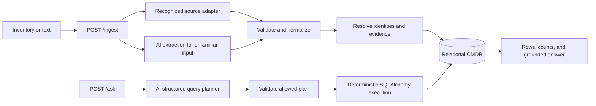
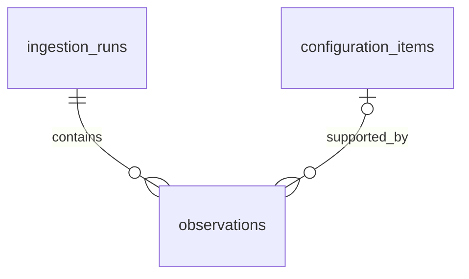

# AI-first CMDB: technical design

This document explains how the CMDB combines inventory records, handles conflicting evidence, and answers questions about devices, users, and applications. It covers the implementation and the tradeoffs made for the [assignment](../STLabs_Backend_TakeHome_CMDB_Junior.md). For setup and commands, see the [README](../README.md#setup).

The main workflows are implemented: upload inventory, inspect saved items, and ask questions. Most tests replace the model responses so they can run offline. Separate live checks use synthetic data to check extraction and replay. Those checks tell us how the tested examples behaved; they do not establish support for every vendor export.

## 1. Overview and goals

A configuration item (CI) is something the organization tracks. This project handles **devices, users, and applications**. A laptop's operating system is an attribute. Its assignment to a person is a relationship. Keeping those connections lets us ask questions across inventories, such as which devices belong to users without MFA.

Combining exports is harder than reading their formats. Two systems might use different IDs for the same device, disagree about its status, or identify its owner only by name. The design needs a way to handle each case without making a bad match.

Uploads are converted into a common record format before they reach the database. Known layouts have adapters; unfamiliar input can use AI extraction. AI also turns questions into query plans. The backend checks both kinds of output and handles matching, saving, and querying.

I focused on making uploads reliable and keeping enough evidence to explain the results. Another source can use this workflow if it maps to the existing CI types and relationships. A new CI type or queryable attribute needs a model change. Upload and query limits bound each request; they do not limit the database to the sample files.

## 2. Architecture at a glance



Uploads and questions use the same data model. An upload produces records and proposed relationships. A question produces a read-only query plan. Pydantic checks the model's output before either workflow can use it.

Routes handle HTTP requests. Adapters read source-specific layouts, and ingestion services handle normalization, matching, and saving. The AI client calls OpenRouter; the query compiler turns validated plans into SQLAlchemy queries. Keeping these responsibilities separate makes each part easier to test, including tests that run without a network connection.

A versioned configuration file defines the organization and its sources. Each source specifies an adapter, which identifiers it can share with other systems, any attributes it is trusted to settle, and which timestamps are reliable. App aliases are configured there too. An uploaded file cannot give itself more authority or choose another organization's identifiers.

The prototype serves one organization per deployment. IDs and upload history still include the organization so matching stays within that scope. Supporting multiple tenants would also require authentication and authorization.

## 3. Technology choices and tradeoffs

| Choice                                    | Reason and tradeoff                                                                                                                                               |
| ----------------------------------------- | ----------------------------------------------------------------------------------------------------------------------------------------------------------------- |
| Python 3.12+ and FastAPI                  | Clear request models and a small REST service with generated API documentation. Synchronous request handlers are sufficient for the prototype.                    |
| SQLAlchemy 2.x                            | Typed relational models, transactions, and composable safe queries. More modeling work than storing documents, but relationships and constraints remain explicit. |
| SQLite                                    | Easy local setup and isolated tests. Suitable for the demonstration; concurrent writes are limited.                                                               |
| Pydantic v2                               | One validation boundary for API inputs, normalized records, extraction output, and query plans. Schema validity does not itself prove a fact is true.             |
| OpenRouter through a small HTTP client    | Configurable model access without an agent framework. Model reliability, cost, latency, and data exposure remain operational concerns.                            |
| pytest                                    | Unit tests for policy and integration tests for complete workflows. AI responses are mocked by default.                                                           |
| Standard JSON/CSV readers and safe PyYAML | Deterministic parsing of recognized structures. A parser understands syntax; adapters still need to understand each source's meaning.                             |

I chose a relational database because matching IDs and maintaining relationships both benefit from constraints and joins. The queries follow short paths through the data, so a graph database would add setup without much benefit here. A vector database would not help with exact identity matching or filters such as MFA=false.

Dependencies have compatible version ranges in `requirements.txt`, rather than an exact lock file. Environment settings choose the OpenRouter model and credentials; a local token file is also supported. Credentials should stay out of source control, test data, and coding transcripts.

## 4. Data model and entity relationships

Each CI has an internal UUID, separate from its attributes and source evidence. The UUID stays the same when a hostname or email changes. Device, user, and application tables hold the fields used in queries. External identifiers connect incoming records to those internal IDs.

**Provenance** is the record of where a fact came from. If a device's status looks wrong, we need to find the source and observation that supplied it. The database keeps the normalized observation and original parsed record for that purpose. It does not provide a full historical CMDB or audit-event system.

### Tables

SQLAlchemy uses joined-table inheritance: a CI row links to one device, user, or application row. SQLite stores UUIDs as `VARCHAR(36)`. A custom datetime type restores UTC timezone information on reads, JSON fields use SQLAlchemy's JSON type, and CHECK constraints restrict enum-like values. Startup calls `create_all` to create missing tables; schema migrations are not implemented.

In the table below, `!` means required and `?` means nullable. Every `id` is a primary key, and the listed references are foreign keys. There is no public delete endpoint.

| Table                 | Columns                                                                                                                                                                                                                                                                                     | Constraints and initial indexes                                                                                                                                                                                    |
| --------------------- | ------------------------------------------------------------------------------------------------------------------------------------------------------------------------------------------------------------------------------------------------------------------------------------------- | ------------------------------------------------------------------------------------------------------------------------------------------------------------------------------------------------------------------ |
| `configuration_items` | `id UUID!`, `organization_id TEXT!`, `kind TEXT!`, `display_name TEXT!`, `is_reference BOOLEAN!`, `field_state JSON!`, `created_at DATETIME!`, `updated_at DATETIME!`                                                                                                                       | Kind is device/user/application. Index `(organization_id,kind,id)`. Exactly one matching subtype, enforced by the write service in one transaction. `field_state` is explained below.                              |
| `devices`             | `ci_id UUID! PK/FK configuration_items`, `hostname TEXT?`, `ip_address TEXT?`, `mac_address TEXT?`, `serial_number TEXT?`, `os_family TEXT?`, `os_version TEXT?`, `location TEXT?`, `status TEXT?`, `encrypted BOOLEAN?`, `device_type TEXT?`, `department TEXT?`, `last_checkin DATETIME?` | Status active/inactive/unknown when present. Nonunique hostname index; indexes `(os_family,ci_id)` and `(status,ci_id)`. Hostnames, IPs, and MACs are not identity constraints.                                    |
| `users`               | `ci_id UUID! PK/FK configuration_items`, `name TEXT?`, `email TEXT?`, `team TEXT?`, `department TEXT?`, `title TEXT?`, `status TEXT?`, `mfa_enabled BOOLEAN?`, `last_login DATETIME?`                                                                                                       | Status active/inactive/suspended/unknown. Index `(mfa_enabled,ci_id)`; nonunique email lookup index. Identity uniqueness is enforced in identifiers, not the email projection.                                     |
| `applications`        | `ci_id UUID! PK/FK configuration_items`, `name TEXT?`, `app_type TEXT?`, `vendor TEXT?`, `category TEXT?`, `deployment TEXT?`, `owner_team TEXT?`, `reported_user_count INTEGER?`, `sso_enabled BOOLEAN?`                                                                                   | Type saas/on_prem/unknown. CHECK count >= 0. Nonunique name index. Reported count is distinct from counted user-access edges.                                                                                      |
| `user_groups`         | `user_id UUID! FK users`, `group_name TEXT!`                                                                                                                                                                                                                                                | Composite PK `(user_id,group_name)`. Groups remain many-valued; membership does not automatically imply team.                                                                                                      |
| `entity_identifiers`  | `id UUID!`, `ci_id UUID! FK configuration_items`, `namespace TEXT!`, `value TEXT!`, `created_at DATETIME!`                                                                                                                                                                                  | UNIQUE `(namespace,value)`; index `ci_id`. The namespace contains organization, CI type, authority, and identifier type. Every persisted CI has at least one identifier.                                           |
| `relationships`       | `id UUID!`, `from_ci_id UUID! FK configuration_items`, `to_ci_id UUID! FK configuration_items`, `relation_type TEXT!`, `created_at DATETIME!`                                                                                                                                               | UNIQUE `(from_ci_id,to_ci_id,relation_type)`; CHECK endpoints differ. Index `(from_ci_id,relation_type,to_ci_id)` and reverse `(to_ci_id,relation_type,from_ci_id)`. Partial UNIQUE on from_ci_id for assigned_to. |
| `ingestion_runs`      | `id UUID!`, `organization_id TEXT!`, `source_id TEXT!`, `format TEXT!`, `payload_sha256 TEXT!`, `policy_version TEXT!`, `received_at DATETIME!`, `completed_at DATETIME!`, `result JSON!`                                                                                                   | UNIQUE `(organization_id,source_id,payload_sha256,policy_version)`. Stores committed processing outcomes, including warnings and quarantined records.                                                              |
| `observations`        | `id UUID!`, `run_id UUID! FK ingestion_runs`, `record_key TEXT!`, `ci_id UUID? FK configuration_items`, `observed_at DATETIME?`, `raw_record JSON!`, `normalized_record JSON!`, `origin TEXT!`, `resolution_status TEXT!`                                                                   | UNIQUE `(run_id,record_key)`; index `(ci_id,observed_at)`. Origin adapter/ai; status resolved/unresolved/identity_conflict. A null ci_id is allowed for quarantined evidence.                                      |

`field_state` explains why an attribute has its current value. An observed field is marked `selected` or `conflict` and includes the supporting observation IDs. Both a missing value and an unresolved conflict appear as NULL in ordinary queries, but the detail endpoint tells them apart. `display_name` is just a readable label, with the kind and UUID as a fallback; matching does not rely on it.

An observation keeps the source's proposed relationships alongside its normalized attributes, including resolved target IDs when available. It belongs to the CI that supplied the information, rather than to a relationship row that might later change. This keeps the evidence for an old assignment without requiring a full relationship-history model. Nested records have their own stable paths within the upload. Extra source fields remain in the saved record, but are not automatically available as query filters.

### Core CMDB model

The core model stores configuration items, their identifiers, and their relationships.

```mermaid
erDiagram
  configuration_items ||--o| devices : specializes
  configuration_items ||--o| users : specializes
  configuration_items ||--o| applications : specializes
  users ||--o{ user_groups : has
  configuration_items ||--|{ entity_identifiers : identified_by
  configuration_items ||--o{ relationships : from
  configuration_items ||--o{ relationships : to
```

Before saving, the ORM session checks that each CI has exactly one matching subtype, its identifiers have the right scope, and its relationships connect valid types. Database constraints also enforce unique keys and foreign-key references.

### Ingestion and provenance

Each upload creates an ingestion run. Its observations link to CIs when the identifiers can be resolved. Records with missing or conflicting identity stay unlinked so their evidence is still available. The diagram below uses the same `configuration_items` table as the core model.



### Relationships

| Type              | Direction                               | Meaning                                                                                      |
| ----------------- | --------------------------------------- | -------------------------------------------------------------------------------------------- |
| `assigned_to`     | device → user                           | Current assignment, at most one user per device. It does not establish legal ownership.      |
| `uses`            | user → application                      | Observed access or assignment, not measured usage frequency.                                 |
| `depends_on`      | device/application → device/application | Explicit dependency. Cycles are allowed; transitive analysis is deferred.                    |
| `integrates_with` | application → application               | A source's directed integration assertion. It does not imply a dependency or a reverse edge. |
| `owned_by`        | application → user                      | Explicitly identified human owner. Team owners instead populate owner_team.                  |

Relationships connect CI IDs within one organization. To find a device's assignee, a query follows its outgoing `assigned_to` relationship. To find an application's dependents, it follows incoming `depends_on` relationships. These lookups use indexed IDs, so they do not depend on comparing names.

NULL means the value is missing or could not be settled. For example, a user with unknown MFA status must not match a filter for MFA=false. The detail response includes `field_state` and evidence to explain the missing value. A stored boolean false requires an explicit observation selected by the conflict rules.

## 5. Identity resolution

Identity resolution decides whether an incoming record describes something already stored. This happens before choosing which of its attribute values to keep. A wrong match could give one person another person's access or MFA status, so the resolver uses stable identifiers and configured rules.

### Identifier namespaces

An ID needs context. Device 42 in one inventory system may have nothing to do with device 42 in another. A shared helper builds every identifier namespace from four components:

`(organization_id, ci_type, authority_id, identifier_type)`

The helper stores that tuple as a canonical JSON-array string. All four components are required and validated. The identifier value is stored separately, using the normalization rules for that identifier type. For example:

| Namespace tuple                                        | Value    | Interpretation                                                          |
| ------------------------------------------------------ | -------- | ----------------------------------------------------------------------- |
| `["org-a","device","jamf-prod","device_id"]`           | `42`     | Jamf's local device 42.                                                 |
| `["org-a","device","inventory-east","device_id"]`      | `42`     | Another system's device 42; not the same key.                           |
| `["org-a","device","approved-serial-domain","serial"]` | `SN-804` | Serial identity shared only by sources configured to trust this domain. |

A unique constraint on `(namespace, value)` prevents the same scoped ID from belonging to two CIs. The helper gives the same scope the same string every time, and the resolver checks the organization's and CI type's agreement with the target item. Keeping the components in one namespace avoids duplicate columns, but it makes consistent use of the helper important. Separate columns would be easier if we needed frequent reports on individual scope components.

Case handling follows the issuing system's rules. Email can link sources only when configuration explicitly allows that shared identifier and defines its normalization. Lowercasing an address alone does not make it safe: mailboxes can be shared or accounts recycled. Serial numbers also need a trusted scope. Blank identifiers are dropped, and conflicting stable IDs cause quarantine. Adapters or source configuration still need to screen out vendor-specific placeholder IDs. IPs, MACs, and hostnames are descriptive fields by default.

### Resolution behavior

Before saving a record, the resolver looks up **all** its usable identifiers:

- If none match and at least one trusted key exists, create a CI and attach the keys.
- If all matched keys point to one CI, reuse it and attach compatible new keys. Different systems can therefore identify one CI through a shared trusted key.
- If keys point to different CIs, do not merge, update attributes, or attach identifiers. Quarantine that record as an identity conflict and preserve it in observations with the candidate CI IDs.
- If there is no usable identifier, keep the record as unresolved evidence. A name alone is not enough to create a person.

Suppose a device's local inventory ID matches CI A, but its trusted serial matches CI B. The resolver keeps the record as conflicting evidence and returns both candidate IDs. Neither existing CI is changed. Someone needs to correct the data or configuration before uploading it again; the prototype has no automatic merge or reconciliation UI.

Records with agreeing identifiers resolve to one CI, and unique constraints prevent duplicate relationships. If those records disagree about an attribute, the conflict policy below decides what to show. Two devices can share a hostname and still be separate items. User names are never enough to merge records, even if a name happens to be unique in the current database.

### Configured aliases and reference CIs

An export may say that a user uses “GitHub” without providing an application ID. Source configuration can map that label to a canonical name within a declared name authority. A later catalog upload can add the app's external ID. Sources can share that authority when their labels are known to identify the same applications. Aliases stay within this configured scope. Mapping a label directly to an external ID is not implemented.

When an app has a usable identifier but no detailed inventory record, the backend creates a **reference CI** with `is_reference=true`. A later upload can fill in its details. Without a configured shared name authority, the reference stays local to its source, so similarly named deployments remain separate. Ambiguous alias mappings are configuration errors; ambiguous names in questions ask the user to clarify. If later evidence points to two existing CIs, it goes through the identity-conflict path.

## 6. Ingestion pipeline

Ingestion first translates a source into common records, then matches and saves what those records report. Adapters handle the differences between layouts. The shared services apply the same identity and conflict rules regardless of format, and keep the source evidence so the saved result can be explained.

### Request and workflow

```json
{
  "organization_id": "org-a",
  "source_id": "inventory-east",
  "format": "json",
  "content": "[{\"asset_id\":\"A-17\",\"hostname\":\"workstation-17\"}]"
}
```

The selected source determines the organization, adapter, and identity rules. Named adapters expect JSON, CSV, or YAML; unfamiliar layouts and text can use AI extraction. In the envelope above, `content` contains the data itself. The server does not open a path or fetch a URL from that field. Observation times come from explicitly configured source fields.

1. **Check the request and parse the input.** Validate the source, organization, and size limits. Known formats use their parsers. Broken JSON or CSV returns an error instead of falling back to AI. YAML uses a safe loader; duplicate keys, duplicate headers, and malformed rows are rejected.
2. **Extract records.** The adapter, or AI for an unfamiliar layout, produces devices, users, and applications with their identifiers, attributes, relationships, and source evidence. Pydantic checks the resulting contract for either path.
3. **Normalize fields.** Convert statuses, OS descriptions, booleans, timestamps, and addresses into the shared format while keeping their original values. An unrecognized encryption description stays unknown, and group membership does not automatically become a team.
4. **Match items and relationship targets.** Check identifiers across the batch and flag records with missing or conflicting identity. Create eligible items before adding relationships so a record can refer to another item later in the file. An unresolved target produces a warning rather than a guessed link.
5. **Save the result.** Apply the conflict rules and save current values, relationships, observations, and the run summary in one transaction. Identity lookups are checked inside that transaction to avoid races with another upload.
6. **Return a summary.** Report record, item, and relationship counts, along with quarantined records and unresolved references. Warning details include the source record paths and are capped to keep the response bounded.

An upload can contain at most 1 MiB of content, 1,000 extracted entity records, and 5,000 relationship assertions. Unfamiliar input sent to AI has a smaller 64 KiB limit. Parsed documents allow up to 32 levels of nesting and 100,000 nodes, including CSV headers and rows. Oversized integers and timestamps that overflow during UTC conversion return input errors. Requests over these limits are rejected in full. The limits apply to one upload, not the size of the database.

### Source authority, freshness, and conflict

Sources can disagree because they took snapshots at different times, track different details, or contain mistakes. Upload order should not decide which one wins. The file format does not establish trust either.

For each field with a single value, the service compares the stored observations:

1. Check whether configuration gives one source priority for this attribute. If so, use its nonmissing reports first. Other observations stay available as evidence and can fill fields the trusted source does not supply. Only one source can have this priority per attribute.
2. Otherwise, use the latest reliable observation when all competing reports have comparable timestamps. Reports with the same value agree. If a conflicting report has no timestamp, or two reports disagree at the same time, timestamps cannot settle the conflict.
3. When conflicting values remain, store NULL for the current field, keep every candidate, and return a warning. Uploading a file later does not make its values more trustworthy.

An export time can date a snapshot when the source documents that meaning and configuration explicitly selects it. A record's modification time can only date fields it actually covers. `received_at` is the time of upload, which may be much later than the data was collected. `last_login` and `last_checkin` describe activity; they cannot decide which status, owner, or profile value is newer.

New contradictory evidence can make a previously usable value unresolved. Keeping the first value would hide the disagreement. Missing, null, and blank inputs do not erase a known value. Ordinary filters treat missing and conflicted fields as unavailable; the detail endpoint explains which case applies.

The selection function recalculates affected fields from the observations already stored. Changing source policy requires reprocessing the affected data; it does not update existing results automatically. Confidence scores, automatic correction, evidence expiry, and source-health checks would need additional work.

### Relationships, provenance, and idempotency

A device can have one current assignee, so competing `assigned_to` reports follow the same source and timestamp rules as scalar fields. If they cannot be settled, no current assignment is shown and the candidate targets remain in evidence. A name-only reference cannot replace an identified assignee.

Access, groups, integrations, dependencies, and human-owner links accumulate across uploads. Leaving one out of a later file does not remove it. An integration is stored as an integration; it never automatically creates a dependency.

Each observation records the upload, source record path, original parsed record, normalized evidence, resolution result, and a reliable observation time when available. `field_state` links the current attributes and assignment to those observations. This supports debugging updates, although historical relationship queries are not implemented. CSV rows are kept as parsed strings rather than an exact copy of the original file bytes.

The backend recognizes an exact repeat using the organization, source, content hash, and policy version, including adapter and alias settings. It returns the previous result with `replayed=true` and adds no rows. Reformatting a file can create another observation, but it should not duplicate CIs or relationships. Stable record paths prevent duplicate unresolved records within a run. To reprocess a quarantined identity, correct the content or change the policy version; otherwise replay returns the same outcome.

### Transactions and failures

Parsing and any AI calls finish before the write transaction starts. The transaction then saves valid records, quarantined evidence, selected values, relationships, and the upload summary together. Quarantine keeps a record's evidence without applying its proposed changes. An unexpected validation or persistence failure rolls back the whole run. Documents rejected while parsing are never saved.

SQLite runs with foreign keys, WAL, and a short busy timeout. A writer acquires `BEGIN IMMEDIATE` before looking up identities, preventing another writer from changing them between lookup and insert. Unique constraints provide another check against duplicate IDs and relationships. If two requests repeat the same upload concurrently, the service checks for a committed result after rollback. If it still cannot finish because the database is busy, it returns a retryable 503. A general retry system for concurrent writes is not implemented.

Example successful processing response:

```json
{
  "run_id": "ac57ec20-8720-4f64-b14e-07e666060fd3",
  "replayed": false,
  "records": {"received": 1, "resolved": 1, "quarantined": 0},
  "entities": {"created": 1, "updated": 0, "unchanged": 0},
  "relationships": {"created": 0, "removed": 0, "unchanged": 0},
  "warning_count": 0,
  "warnings": [],
  "unresolved_reference_count": 0
}
```

The response counts extracted records, distinct CIs, and relationships separately from observations. An identity conflict adds to the quarantined count and returns candidate CI IDs. An attribute conflict may change the current value to NULL and produces a warning for that field. At most 50 warning details are returned, while the total warning count is kept.

## 7. AI integration

Extraction is tested with mocked provider responses and optional live checks using [synthetic fixtures](../input_data/unfamiliar/manifest.json). The live checks upload the example files and check selected fields, supporting evidence, and repeat uploads. Other layouts still need to be tested separately.

AI helps read unfamiliar exports and lets people ask questions without knowing the schema. I kept matching and database access in application code because a plausible model response is not enough reason to merge two identities or run a query.

For extraction, OpenRouter receives the input, the record schema, and the supported relationships. It is asked to leave missing facts unset and cite a source location or exact quotation for extracted identifiers and fields. Pydantic checks the output's types and limits. Evidence checks verify that identifier values appear in the submitted content. Source configuration still decides which identifier types and authorities can be trusted for matching.

Validation can catch malformed records and unsupported evidence, but cannot prove every association the model makes. AI-derived observations are labeled so they can be inspected later. Known sources continue to use their adapters: malformed known input returns an error instead of going to AI. Even an unfamiliar source needs an organization and identity policy, whether or not it needs a custom adapter.

When the extracted output fails validation, the service gives the model one correction attempt. It includes a bounded copy of the previous output and a hint about the failure. Malformed provider responses, truncation, and connection failures return directly. Invalid output after correction returns 502; provider unavailability or rate limiting returns 503; a timeout returns 504. Nothing is saved until validation succeeds.

The correction hint depends on the evidence problem. If entities and their assignments are in separate JSON arrays, it explains how to cite an enclosing object for the record while keeping precise field pointers. If a person's facts are spread across several sentences, it asks for an exact passage containing all the field quotes. The revised output must pass the same checks. This can still reject an extraction that mixes quotation and pointer styles or associates facts incorrectly.

Questions and uploads may contain instructions intended to influence the model. The model has no database tools and receives no credentials in its prompt. Extraction sends the uploaded content for that request; planning sends the question and supported query fields and relationships. Because uploads may contain personal or confidential information, a deployment needs an approved provider-data policy. The prototype does not log complete prompts, payloads, or secrets by default.

## 8. Natural-language querying

`POST /ask` plans a question, resolves its references, and executes a validated database query. `POST /ask/plan` previews a plan without reading the database. The CLI executes questions by default; `--plan-only` requests a preview.

A preview returns `executed: false` with a plan, an unsupported reason and example questions, or a clarification question. The model can ask about unclear intent. Looking up ambiguous names and candidate IDs happens later, against the database. Names, emails, hostnames, and UUIDs in the plan must come from the question, and pagination comes from the request. Invalid fields or relationship directions get one correction attempt. These checks cannot guarantee the model understood the question.

For “Which devices belong to users without MFA?”, a plan selects devices, follows each device's assignment, and checks whether that user has MFA=false. The model describes those steps in a constrained JSON structure. Application code validates it and builds the SQL query.


The model does not receive stored CMDB records or write SQL. Once the query finishes, application code builds the answer from the rows and count. A second model call to phrase that result would add cost without much benefit here.

### Limited plan schema

A version-1 executable plan has:

| Field             | Meaning                                                                                                                    |
| ----------------- | -------------------------------------------------------------------------------------------------------------------------- |
| `operation`       | list or count.                                                                                                             |
| `root`            | device, user, or application. Organization scope is supplied by the server, never the model.                               |
| `where`           | AND of scalar predicates: `{field, operator, value}`. Operators eq, in, is_null; is_null omits value.                      |
| `exists`          | AND of related-entity constraints containing relation, direction (out/in), target_kind, where, and optional nested exists. |
| `limit`, `offset` | Bounded list pagination. Count ignores pagination. Request envelope values override model proposals.                       |

The schemas reject extra fields. A registry lists which fields can be queried for each type: hostname, OS family, status, and encryption for devices; name, email, team, status, and MFA for users; name, type, and owner team for applications. Each type also supports an exact `ci_id`. Values must have the right type. Missing and conflicted values match `is_null`, but never `eq false`.

A plan can follow at most two relationship steps, with up to eight predicates and four related constraints at each node. An `in` predicate accepts up to twenty values. Lists default to 50 rows, allow 1–100, and accept offsets from 0 to 10,000. The language supports count but excludes arbitrary projections, SQL fragments, other aggregates, OR/NOT, and transitive traversal. Keeping this scope small makes its behavior easier to check.

For a generic device/security question:

```json
{
  "version": 1,
  "operation": "list",
  "root": "device",
  "where": [],
  "exists": [{
    "relation": "assigned_to",
    "direction": "out",
    "target_kind": "user",
    "where": [{"field": "mfa_enabled", "operator": "eq", "value": false}],
    "exists": []
  }],
  "limit": 50,
  "offset": 0
}
```

Each related constraint must be satisfied by one related item. To require a device's assignee both to lack MFA and to use an app, put the app constraint inside that same assignee constraint. Two separate sibling constraints could match two different people, which would answer a different question.

The compiler builds correlated EXISTS expressions with bound parameters and fixed SQLAlchemy models. It checks relationship direction and endpoint types against the registry. EXISTS prevents a CI with several matching relationships from appearing multiple times. Counts run before pagination; lists sort by CI ID. App names go through configured alias and identifier lookup, and multiple matches require clarification.

### Query execution and reference lookup

SQLAlchemy Core aliases distinguish the tables at different steps of a query, including two applications in a dependency query. Writes still use the ORM. Before running a query, the service validates the plan again and resolves its names and IDs. The provider call finishes before a database session opens. Count, page results, and coverage warnings then use one read transaction, and the answer summarizes those results.

Names, hostnames, and emails must match current attributes exactly, apart from SQLite's ASCII case-insensitive comparison. Non-ASCII characters require an exact match; full Unicode collation is not implemented. Application lookup also checks canonical identifiers in configured name authorities using each source's normalization rules.

If a literal name and an alias identify different CIs, the service asks for clarification. It does not try approximate matches, expand aliases across authorities, or merge items. Missing references produce an empty match and a warning. For `in`, known values can still match while missing values are reported individually. Lookup does not assume a name is unique just because another filter might later narrow the result.

The returned plan keeps the names as the user wrote them. `resolved_references` records the matching CI ID, or null when nothing matched. An ambiguous name returns up to 20 candidate IDs in UUID order and the full `candidate_total`; the user can ask again with an exact ID. A whole plan can contain at most 100 distinct literal references. Going over that limit returns unsupported rather than silently removing conditions, and the smaller per-node limits still apply.

Warnings help explain what a query could miss. Coverage checks follow each relationship path and count distinct CIs after applying ancestor filters. They omit the current node's filters and sibling or descendant EXISTS conditions, so they can reveal missing facts that the requested filter would otherwise hide. Warning counts can overlap; they are not extra result rows.

Unknown and conflicted fields are reported separately. A query for `is_null` deliberately includes unavailable values, so it does not warn that those values were excluded. Other warnings flag reference-only items and conflicting assignments. Unresolved relationship counts describe stored observations, which may repeat the same real-world assertion. Outgoing checks include reachable source items and unlinked observations. Incoming checks cover the organization because an unresolved target cannot be attached to a query path. Missing-relationship checks cover the organization and endpoint type. Every answer notes that the database is not a complete live directory; zero matches also carry an absence-of-evidence warning.

Coverage checks run SQL aggregates along the plan's bounded paths instead of loading the database into memory. They identify recorded gaps, but cannot measure overall completeness or prove why a result occurred. Query results reuse the inventory response format, which adds ORM reads for each page. Reads do not acquire a write lock. A busy database returns a sanitized 503.

### Coverage of required questions

The compiler supports the plans below, and automated tests exercise them. The live model can still misinterpret a question or fail to produce a valid plan.

| Question pattern                                             | Plan                                                                                         |
| ------------------------------------------------------------ | -------------------------------------------------------------------------------------------- |
| Users without MFA                                            | user where mfa_enabled eq false. Suspended users remain included unless explicitly filtered. |
| Devices running macOS                                        | device where os_family eq macos.                                                             |
| Users of an application                                      | user with outgoing uses to the named application.                                            |
| Devices assigned to users without MFA                        | device with outgoing assigned_to to user where mfa_enabled eq false.                         |
| Devices assigned to users without MFA who use an application | Same assigned_to constraint, with a nested outgoing uses constraint on that user.            |
| Applications depending on a named application                | application with outgoing depends_on to that target.                                         |
| Number of active devices                                     | count device where status eq active.                                                         |

### Answers and limitations

An answered query returns matching rows or a count, the plan, and any relevant warnings. Zero matches means the stored data did not establish a match. Responses flag missing or conflicted fields, unresolved relationships, and relationship types with no recorded edges. These checks cover the supported queries; they do not score the completeness of an organization's inventory.

For a question outside the supported language, the planner returns `unsupported`, a reason, and suggested questions. An ambiguous database name returns `clarification_required` with candidate IDs. Invalid plans return 502 after one correction attempt. The compiler only accepts its fixed fields and operations, so instructions in a question cannot add tables, writes, or unrestricted traversal.

## 9. API design

Uploads use `POST /ingest` or `POST /ingest/raw`. `GET /ingest/sources` lists the configured choices, and the inventory endpoints return saved items. `POST /ask/plan` previews a plan; `POST /ask` also runs it and returns the answer.

All responses are JSON. Lists use `{data,total,limit,offset}` and sort by ID, with defaults of 50 rows and offset 0. The maximum limit is 100 and maximum offset is 10,000. Item IDs are UUIDs and timestamps use UTC ISO 8601. Inactive users and reference CIs remain included unless a filter excludes them.

| Endpoint         | Request                                                             | Success response                                                                                                         | Expected errors                                                                                                |
| ---------------- | ------------------------------------------------------------------- | ------------------------------------------------------------------------------------------------------------------------ | -------------------------------------------------------------------------------------------------------------- |
| `POST /ingest`   | Multipart file, direct raw body, or legacy envelope from section 6. | 200 run summary, replay flag, counts, quarantine and warnings.                                                           | 413 limit exceeded; 422 malformed/invalid input or unknown configuration; 502/503/504 AI failure; 503 DB busy. |
| `GET /devices`   | Optional status, os_family, limit, offset.                          | 200 paginated common fields and device attributes, assigned_user_id or null.                                             | 422 invalid filter/pagination; 503 DB busy.                                                                    |
| `GET /users`     | Optional status, mfa_enabled, limit, offset.                        | 200 paginated common fields and user attributes, including groups.                                                       | 422 invalid filter/pagination; 503 DB busy.                                                                    |
| `GET /apps`      | Optional app_type, limit, offset.                                   | 200 paginated common fields and app attributes, reported_user_count and separately calculated observed_assignment_count. | 422 invalid filter/pagination; 503 DB busy.                                                                    |
| `GET /ci/{id}`   | UUID path, optional edge_limit and edge_offset.                     | 200 common fields, subtype attributes, identifiers, field_state, incoming/outgoing edges, and evidence summary.          | 404 missing CI; 422 invalid UUID/pagination; 503 DB busy.                                                      |
| `POST /ask/plan` | Question (1–2,000 characters), limit 1–100, offset 0–10,000.        | 200: executed=false, planner_version, result (planned/unsupported/clarification_required). No database access.           | 422 invalid request; 502 invalid model output; 503 unavailable; 504 timeout.                                   |
| `POST /ask`      | Question (1–2,000 characters), limit, offset.                       | 200 answered, unsupported, or clarification_required response.                                                           | 422 invalid envelope; 502/503/504 AI failure; 503 DB busy.                                                     |

Each item includes its ID, kind, display name, reference status, creation time, and update time. Type-specific fields sit in `attributes`, alongside a `has_conflicts` flag. Lists exclude raw source records. Details show source, run, and observation IDs; record paths; reliable observation times; and selected or conflicting values.

The detail endpoint returns up to 20 recent observation summaries and their total count. Browsing full raw evidence is not implemented. Relationships have their own pagination and sort by direction, type, and edge ID. An application team owner is stored in `owner_team`; an identified person is connected by an `owned_by` relationship.

Example ask request:

```json
{"question":"How many active devices are there?","limit":50,"offset":0}
```

Illustrative response, with an example count rather than a fixture expectation:

```json
{
  "status": "answered",
  "answer": "7 devices have an observed active status.",
  "plan": {
    "version": 1, "operation": "count", "root": "device",
    "where": [{"field":"status","operator":"eq","value":"active"}],
    "exists": [], "limit":50, "offset":0
  },
  "resolved_references": [],
  "data": null,
  "total": 7,
  "limit": 50, "offset": 0,
  "warnings": [{"code":"recorded_evidence_only","message":"Results describe recorded inventory, not a complete live directory."}]
}
```

For list questions, `data` contains CI records and the response includes pagination. For count questions, `data` is null and `total` gives the count before pagination. Unsupported responses contain `status`, `reason`, and `suggested_questions`. Clarification responses contain `status`, `question`, `candidates`, and `candidate_total`.

All error responses share a shape, including FastAPI validation errors through an exception handler:

```json
{
  "error": {
    "code": "invalid_input",
    "message": "The configured adapter requires hostname to be a string.",
    "request_id": "req-example",
    "details": [{"path":"/records/0","field":"hostname"}]
  }
}
```

A structurally valid record with no usable identifier is saved as quarantined evidence. A malformed field, like the one in the error example, rejects the input instead. Unexpected failures return a sanitized 500 without stack traces or raw provider responses. Identity and attribute conflicts in valid records produce warnings so the evidence can be kept. The prototype has no merge, delete, reconciliation, or configuration-management API.

## 10. Sample Data and Integration Testing

The original files are used unchanged in adapter and integration tests. Their filenames do not determine identity or which source wins a conflict; test configuration supplies those rules. Additional synthetic records cover cases missing from the originals.

### What each fixture exercises

| File                   | Structure, fields, and extracted CIs                                                                                                                                                                                   | Identity, relationships, and edge cases                                                                                                                                                                                                                                                                                                     |
| ---------------------- | ---------------------------------------------------------------------------------------------------------------------------------------------------------------------------------------------------------------------- | ------------------------------------------------------------------------------------------------------------------------------------------------------------------------------------------------------------------------------------------------------------------------------------------------------------------------------------------- |
| `sample_hardware.json` | Array of three flat devices. All have device_id, hostname, assigned_to string, OS, status; IP/location/check-in are incomplete.                                                                                        | Source-local device IDs overlap the other hardware exports under the test configuration. Assignee names alone are unresolved. No serials, user emails, or export time. John's New York location and Jane's inactive status disagree with other evidence.                                                                                    |
| `sample_hardware.csv`  | Header plus three rows: device_id, hostname, assigned_to, os, ip_address, mac_address, last_checkin, location, encryption_status, status, device_type, serial_number, department.                                      | Same device IDs and YAML serials. Descriptive encryption strings mean enabled; they are not booleans. OS contains versions. Jane's location contains floor detail. All rows say active. No reliable observation/export timestamp.                                                                                                           |
| `sample_hardware.yaml` | inventory.metadata and nested devices, with assigned_to, hardware, network, operating_system, security, location, status.                                                                                              | Export timestamp is available. User email/employee ID permit three hardware-user CIs and identified assignments. Hardware/model/specification, OS/version/build, encryption, site, operational state, and optional compliance/security fields are available. Secondary fields stay in evidence. John is deactivated; normalize to inactive. |
| `sample_okta.json`     | Array of nine users, each with user_id, name, email, groups, apps, mfa_enabled, last_login, status.                                                                                                                    | 25 access assignments to 15 distinct application labels. Carlos S., Michael Brown, and Alex Johnson explicitly lack MFA; Alex is suspended. No export time. Login does not timestamp the account record. Groups are not a single team.                                                                                                      |
| `sample_app.json`      | inventory_metadata, six applications, summary. Common fields: app_id, name, vendor, app_type, category, deployment, owner, users_count, integrations, SSO. Optional costs/renewals or server location/version/contact. | Explicit export time. Six catalog apps and 16 directed integrations to 13 target labels. Owner values are teams, not people. Reported user totals are not observed Okta assignment counts. Self-hosted apps can run in AWS; vendor labels do not establish dependencies.                                                                    |

The YAML hardware users have emails `john.doe@example.com`, `jane.doe@example.com`, and `sarah.chen@example.com`. The similarly named Okta users have `john.d@example.com`, `jane.d@example.com`, and `s.chen@example.com`. The files supply no shared stable ID for these pairs, so the tests keep them as separate users.

### Explicit test configuration

The test configuration uses one organization and gives all three hardware exports a shared device-ID authority. This explicitly assumes their repeated device IDs describe the same inventory. Separate source instances still select each file's adapter. The resolver does not infer any of this from filenames.

The alias-enabled test profile shares an application name authority and maps GitHub to GitHub Enterprise and Salesforce to Salesforce CRM. These are explicit assumptions about the fixtures, kept in configuration. Another test runs without aliases to check that cross-source labels remain separate when no shared identity is configured.

The baseline profile gives no source priority over an attribute. Only the YAML and application exports have reliable snapshot times; hardware check-ins in JSON and CSV cannot stand in for those times. As a result, the contradictory statuses for John's and Jane's devices remain NULL. Sarah's active status agrees across sources. Loading all three hardware files therefore gives **one confirmed active device and two conflicting statuses**. A dated observation cannot automatically overrule an undated contradictory report.

Another profile gives the YAML source priority for device status and location. With that policy, John's device is inactive and Jane's and Sarah's are active, giving a count of two. The test checks configured source trust, not a preference for YAML. Synthetic authoritative sources in JSON and CSV exercise the same rule.

### Expected integration outcomes

The shared hardware authority and app aliases produce 3 devices, 12 users (9 from Okta and 3 from hardware), and 28 applications including references. There are 3 identified device assignments, 25 user-to-app links, and 16 directed integrations. Name-only assignment observations remain unresolved and cannot replace identified assignees. The files do not establish dependencies or human application owners.

The question tests expect three users with MFA=false, two macOS devices, five GitHub users, and the active-device count for the selected policy. Device/MFA queries return no matches because the identified hardware users have unknown MFA and cannot be joined to the similarly named Okta users. Warnings explain that gap. Dependency queries also return no matches and warn that no dependencies are recorded; the integration links cannot answer that question.

Tests change upload order, repeat identical and reformatted content, and add details to reference items. They also cover duplicate hostnames, conflicting device IDs and serials, missing identifiers, and retained conflicting values. Synthetic data supplies positive two-hop queries, dependencies, human owners, and equal-time conflicts. Other checks confirm that login, check-in, and upload times cannot decide which report wins.

<a id="phase-7-integration-verification-implemented"></a>

### Integration tests

The last full offline run passed 528 tests. All 51 deterministic files in the [test file list](../input_data/test_files/manifest.json) are tested through HTTP. Accepted uploads are saved and replayed; rejected uploads leave no partial records. Regression tests cover oversized integers, timestamp overflow, and the CSV node limit. The extraction and query validators also check the complete prompt examples.

The 31 tests in `tests/integration` use temporary file-backed SQLite databases and the real application and provider client. A mocked HTTP transport supplies the model responses, and an unexpected network request fails the test. They need no API key or external service.

Three upload orders are compared against a baseline using stable identifiers, attributes, conflicts, reference status, and relationships. Generated UUIDs and timestamps are ignored. Each run mixes files, pasted text, and JSON envelopes, then repeats the content through different transports. All seven question patterns pass through the provider-response parser, planner, executor, and HTTP response. A separate run disables aliases to check that product-specific matching stays in configuration.

An unfamiliar synthetic export exercises all three CI types and five relationship types through extraction validation, saving, inventory reads, planning, and answers. Restart tests reopen the SQLite file and confirm that IDs and replay survive. Concurrent submissions through different transports commit one run. A real SQLite write lock produces a retryable error, and the request works again once the lock is released.

Failure tests raise errors while selecting current values and just before commit, after the SQL flush. They compare every table with its earlier contents to check rollback, then retry to make sure the failed attempt was not recorded as a successful replay. Identity conflicts and records without keys are different: they intentionally save quarantine evidence alongside valid records.

Provider tests cover timeouts, rate limiting, server errors, invalid response envelopes, malformed JSON, invented IDs, and unsafe plans. Existing data stays intact, and corrected responses let the request succeed. Error tests check 404, 413, 415, 422, 500, 502, 503, and 504 responses for request IDs and safe error messages.

These tests caught a missing `X-Request-ID` header on unhandled 500 responses. Those responses are generated outside the middleware's normal return path, so the shared error helper now adds the header itself. The suite verifies backend behavior with mocked model responses. It does not measure live model quality, process-crash recovery, or performance under load.

## 11. Build phases and code organization

The work was built in eight phases, starting with the data model and adding ingestion, AI, and queries on top. These are implementation phases; the Git commits split some of them into smaller changes.

### Phase 1: Models and contracts

The first step was defining the nine tables, the shared CI identity, and the device, user, and application subtypes. This also established scoped identifiers, UTC timestamp handling, normalized Pydantic records, and the SQLite initializer. Database constraints and session validation enforce the rules that later ingestion relies on. Tests cover identifier uniqueness, subtype consistency, valid relationships, and nullable security fields such as MFA.

### Phase 2: Deterministic ingestion

Adapters were added for the five supplied layouts: hardware JSON, CSV, and YAML, Okta JSON, and application JSON. Each adapter produces the same normalized records while preserving the original data and source paths. Parsing and normalization were kept separate from persistence so input handling could be tested on its own. The preparation CLI made it possible to inspect sample output before writing anything to the database. Tests cover malformed input, unknown values, explicit false values, and configured timestamps.

### Phase 3: Identity, evidence, and persistence

This phase connected normalized records to stored CIs. The resolver uses exact scoped identifiers, quarantines conflicting identities, and creates reference CIs when a trusted key is available without full inventory details. Evidence selection handles source authority, comparable timestamps, and unresolved conflicts. Relationships, observations, and run results commit in one transaction, with replay detection to avoid duplicate imports. The ingestion and inventory endpoints expose this workflow. Tests cover aliases, conflicts, assignments, replay, and rollback.

### Phase 4: Uploads and AI extraction

File uploads and pasted input were connected to the preparation pipeline. Recognized layouts use deterministic adapters; unfamiliar content goes through OpenRouter extraction. Typed schemas and source-evidence checks validate the model's output before it reaches persistence. The provider client handles malformed responses, timeouts, and a bounded correction attempt. Mocked-provider tests cover these paths without needing credentials. Later refinements paired extracted values with their evidence and added synthetic unfamiliar-source checks.

### Phase 5: Natural-language planning

The next step was translating questions into a small query-plan schema. The planner is limited to allowed fields, typed filters, and directed relationships, with explicit unsupported and clarification responses. A preview endpoint and CLI allowed planning to be checked before execution was connected. Tests cover the required question patterns, invalid fields and values, traversal limits, literal references, and attempts to bypass the plan schema.

### Phase 6: Query execution

Validated plans were connected to SQLAlchemy queries and the `/ask` endpoint. This added exact reference lookup, alias handling, clarification for ambiguous names, counts, pagination, and evidence warnings. Nested relationship constraints preserve the meaning of questions about the same user across two hops. Tests distinguish unknown MFA from false MFA and use synthetic data for relationships the supplied fixtures cannot demonstrate. The CLI was later extended to execute questions while retaining a plan-only option.

### Phase 7: Integration testing

Integration tests brought the real API, persistence, provider client, and query services together with a mocked HTTP transport and temporary SQLite databases. They cover mixed uploads, fixture order, replay, restart persistence, concurrent requests, lock contention, and failure recovery. Failure injection also caught the missing request-ID header on unhandled errors, which was fixed in the shared error handler. These tests check that the pieces work together; live model quality is checked separately.

### Phase 8: Documentation and demo

The final phase added setup instructions, API examples, this design document, and a repeatable demo. The offline demo exercises the real services with explicit mocked plans and a temporary database. A live option uses the configured provider for the same questions. Recorded responses help show the API shape, and the coding-session transcript documents the development conversation.

### Code organization

The main modules follow the responsibilities described above:

```text
app/
  main.py
  config.py
  api/              # ingest, inventory, ask routes
  db/               # models and sessions
  schemas/          # API, normalized records, query plans
  ingestion/        # service, normalization, source adapters
  identity/         # namespace construction, resolver, aliases
  ai/               # OpenRouter client, extraction, evidence checks and prompts
  querying/         # planner and prompts, registry, compiler, answers
  reconciliation/   # source policy and conflict handling
tests/
  database/
  ingestion/
  phase3/           # identity, evidence, relationships and persistence
  uploads/
  planning/
  querying/
  integration/
input_data/         # original samples and additional test inputs
requirements.txt
pytest.ini
.env.example
README.md
```

### Running the demo

`python -m app.demo` creates a temporary SQLite database, uploads the five supplied files through the API, inspects provenance, checks replay across upload formats, and asks the seven sample questions. It prints a short summary; add `--json` for the full API responses. The default run uses plans from `examples/demo_questions.json` through a mocked HTTP transport; validation and query execution still use the real services. The server's normal planner does not use those fixtures.

Use `--live` to send the same questions to the configured provider. This can incur charges, and the demo fails if the answers differ from the fixture expectations. The offline run needs no key and leaves the application database alone. Both modes dispose of their engines and remove temporary files when they finish or fail.

Selected offline responses are saved in [demo-output.json](demo-output.json). The [README](../README.md) has setup and verification commands. The [Codex session transcript](codex-session.md) records the development conversation.

Live checks with the default model passed all ten structured unfamiliar fixtures and six of seven example questions in the full run. The two-hop question was inconsistent: it failed in the full run but produced a valid plan after correction in a later isolated check. The prose inventory fixture repeatedly failed evidence validation. These failures returned errors without saving invalid extraction output or executing invalid plans. Live model interpretation remains a limitation.

The installed environment has been used for tests, database initialization, and the offline demo. A fresh dependency download and Python 3.12 run have not been verified. The separate live extraction checks described above should not be confused with the mocked demo results.

## 12. Limitations and production considerations

### Scope

The prototype includes ingestion and inventory endpoints, configurable identity policies, adapters for the supplied layouts, AI extraction, retained evidence, replay detection, typed relationships, and natural-language queries. Database and HTTP tests cover these paths with mocked provider responses. Live extraction checks cover selected fixture fields; they do not establish general model accuracy or complete extraction.

It intentionally excludes authentication, tenant authorization, fuzzy identity matching, automatic CI merging, historical graph queries, relationship revocation, streaming uploads, background jobs, arbitrary graph traversal, cost analytics, and full normalization of every source field. Additive access/group/integration data can become stale; responses describe observed evidence rather than a live authoritative directory. Unresolved records are retained and counted, but there is no reconciliation browser in this timebox.

### Production path

Larger datasets would use object storage, asynchronous jobs, batch identifier lookups, and checkpointed processing. Chunked commits would need an explicit job/partial-progress contract; they must not silently replace the current request-atomic behavior. Evidence retention and pruning also become necessary as observations accumulate.

SQLite serializes writes. A production deployment would move to PostgreSQL, use migrations, native UUID/timestamptz/JSONB, and transactional key/assignment locking or upserts with bounded retry. SQLAlchemy keeps most query logic portable; partial indexes and locking behavior still need database-specific tests. The initial indexes cover identity lookup, CI type, common filters, both edge directions, replay detection, and evidence lookup. Add further indexes only after inspecting representative query plans.

Monitor ingest latency/counts, unresolved and quarantined records, attribute conflicts, replay rate, database lock errors, query latency, unknown-field coverage, AI validation failures, provider timeouts, and token/cost usage. Correlate logs with request/run IDs without using personal data as metric labels. Production also requires secrets management, provider data-handling review, access control, backup/restore, retention/deletion policy, and an auditable way to review identities and policy changes.
